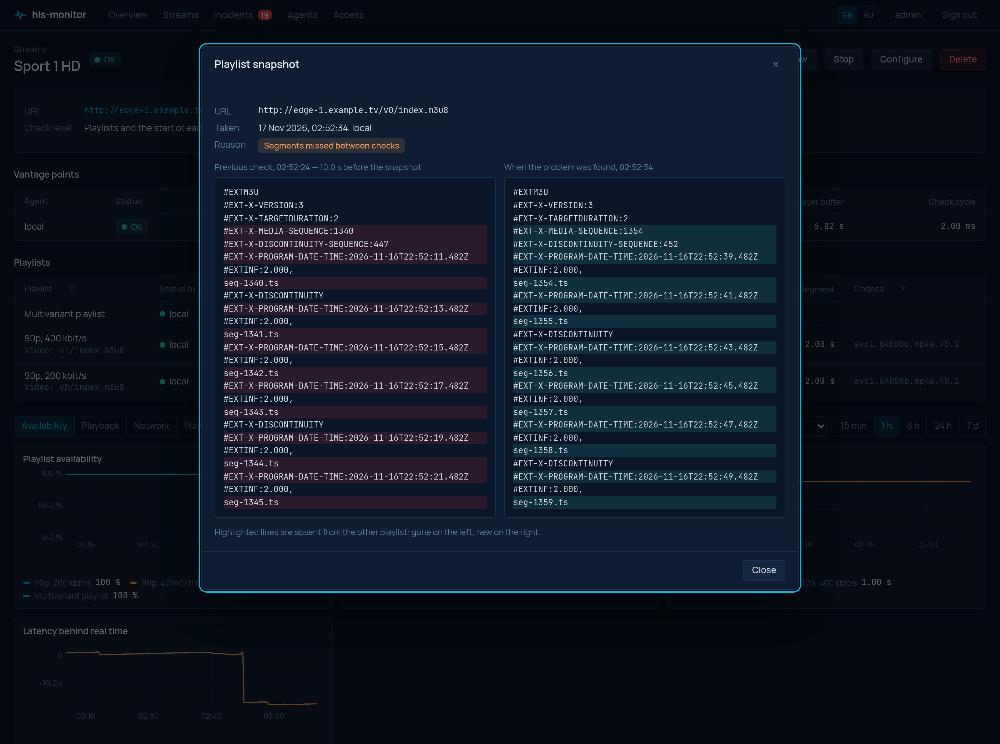
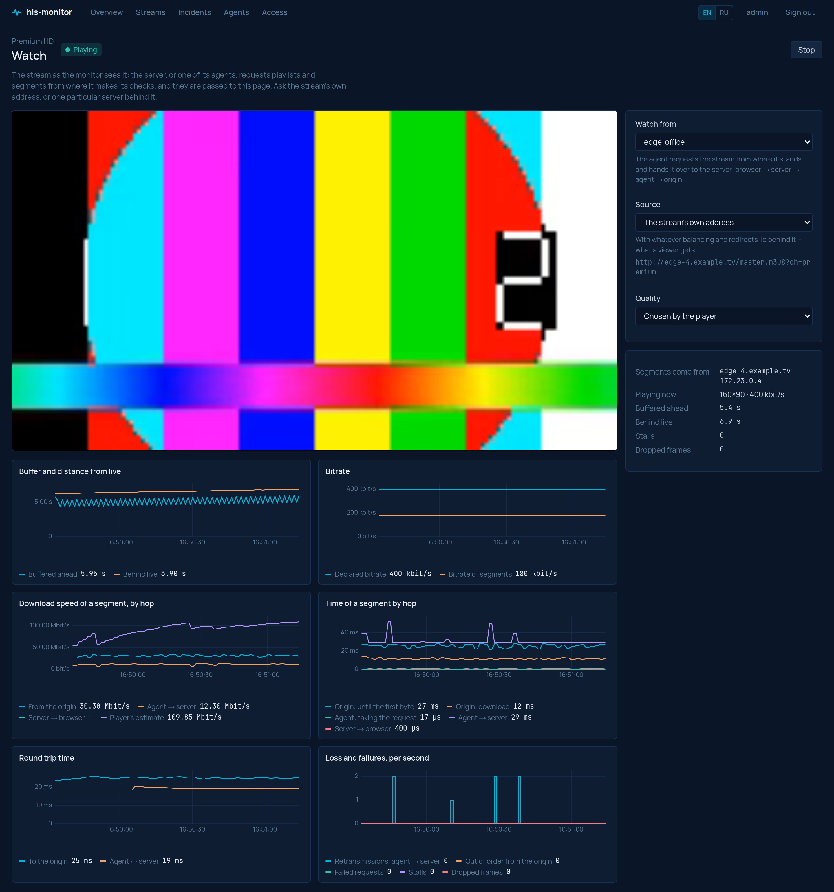
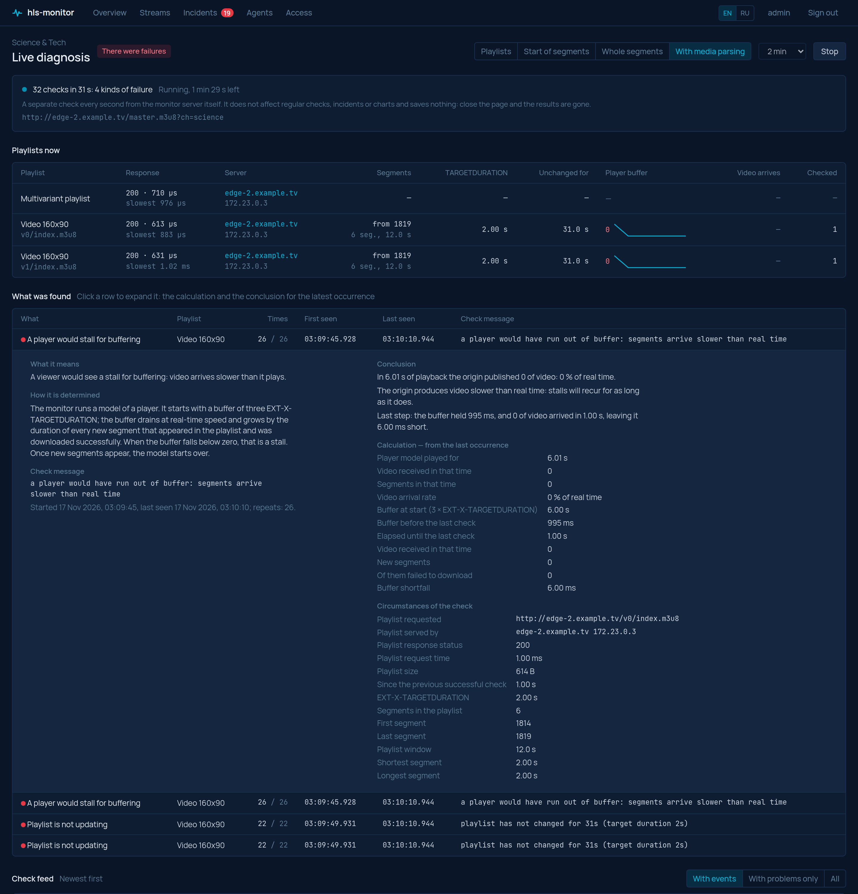

# hls-monitor

English · [Русский](README.ru.md)

> **Proof of concept.** This project was written entirely by Claude, an AI model made by Anthropic, and has not been properly verified. Use it at your own risk.

HLS stream monitoring: a server with a web interface and remote agents that check streams from different points of the network.

The monitor behaves like a player: it reads playlists, downloads every new segment, looks inside MPEG-TS and fMP4, and notices what a viewer would see: unavailability, a stalled playlist, missing segments, slow downloads, timestamp gaps.

The interface is available in English and Russian: the switch is in the top bar, and the default follows the browser language.

## Features

- **Checks at four depths, set per stream:** playlists only; the first kilobytes of every segment; whole segments; whole segments with the container parsed. The cheapest useful level costs a few percent of the stream's bitrate.
- **Looks inside the media without decoding it:** MPEG-TS and fMP4 — continuity counters, tables, tracks, timestamps, frames and keyframes, GOP, frame rate; H.264, HEVC and MPEG-2, interlaced included. Compared with ffprobe on real broadcast segments.
- **Incidents with their evidence:** every finding keeps the figures it was concluded from, the playlist as it was and as it had been at the check before, the redirects followed and the server that answered.
- **Where to look for the cause:** whether other vantage points saw the same, and whether other streams of the same server have it. The same problem on several streams of one server at once is one incident of the server, not one per stream; a problem that comes back within minutes continues its incident.
- **The network by server:** round trip time, loss and the share of requests for every server that answers, the time of the balancer's redirects, and connection setup measured on a connection made for it.
- **Watching through the monitor:** a player in the stream's page, fed by the server or by an agent — browser → server → agent → origin — with the choice of one particular server behind a balancer, and charts of every hop: speed, delay, round trip time and the share of packets lost.
- **Looks at the picture, on request:** a black screen, a picture that stopped, silence, a silent channel of the sound, sound far too quiet, a known slate and a stream whose sound, or nothing at all, can be decoded are found by decoding one frame and a little sound of every stream every few minutes; the latest picture is on the stream's page and in the list of streams.
- **Keeps the segments a finding was made in, on request:** at the first suspicion the segment, its neighbours and the playlists are saved, with what ffprobe says of them and a playlist that plays them offline; kept if an incident comes of it, thrown away if not.
- **A clip going round instead of the programme** is found with no decoding at all: its keyframes come round again byte for byte, and those of a live encoder never do. The clip can then be named a slate, to be known at once next time, or the channel's own, to be left alone.
- **A list of streams that says what is wrong:** a picture of each, the reasons of those not in order, the size of the picture and the bitrate.
- **Live diagnosis:** a separate check once a second with the result shown at once.
- **Agents in other networks:** they make outgoing connections only, queue results on disk while the server is away, and report the state of their own link to the server.
- **Knows when it cannot keep up itself:** an overloaded monitor does not report its own delay as a failure of the streams, and catches up instead of falling further behind.
- **Careful with what it is pointed at:** a stream on a public address cannot lead the monitor into its own network; stream headers with tokens go only to the stream's own site; a playlist that crashes the parser is a finding, not a crash.
- **Its own health:** `/readyz`, Prometheus `/metrics`, a Zabbix template; time series survive an outage of VictoriaMetrics in a queue on disk.
- **Charts you can read:** a click on a legend label leaves one line, Ctrl or Shift adds another, pointing at a label makes its line stand out.
- **Interface in English and Russian,** an API with a Swagger description, users with two roles.

## Screenshots

Taken on a demo stand with simulated streams. The interface moves faster than the pictures: they may be a little behind what you will see.

Overview: figures over all streams, answering servers and the status history of every stream.


A stream: vantage points, playlists and charts.


An incident with the figures it was concluded from.


A playlist snapshot next to the playlist of the previous check.



Watching a stream through an agent, with charts of every hop of the way.



Live diagnosis: a separate check every second, shown as it happens.



## Quick start

Docker and Docker Compose are required.

```sh
git clone https://github.com/hotid/hls-monitor.git && cd hls-monitor
cp deploy/.env.example deploy/.env      # optionally set HLSMON_ADMIN_PASSWORD
docker compose -f deploy/docker-compose.yml up -d
```

This runs the published images `ghcr.io/hotid/hls-monitor-server` and VictoriaMetrics; nothing is built. The images are for x86-64 and 64-bit ARM. Of the repository only `deploy/docker-compose.yml` and `deploy/.env` are needed. `HLSMON_VERSION` in `deploy/.env` selects the release (`latest` by default).

The interface opens at <http://localhost:4000>. The port is published on the loopback only: to reach the server from other hosts, set `HLSMON_BIND=0.0.0.0` in `deploy/.env` or put a reverse proxy in front. If the administrator password is not set, it is generated on first start and written to the log once:

```sh
docker compose -f deploy/docker-compose.yml logs server | grep password
```

Save it or change it at once: the line is gone from the log as soon as the container is recreated, for example on an update.

Compose starts two containers: the server and VictoriaMetrics (the time series storage, not published outside). The server container is limited to 3 GB of memory (`HLSMON_MEMORY_LIMIT`); `HLSMON_CPUS` limits its CPU cores, by default it does not.

To update, change `HLSMON_VERSION` (or keep `latest`) and run `docker compose -f deploy/docker-compose.yml pull && docker compose -f deploy/docker-compose.yml up -d`. To build the images from source instead, see [Development](#development).

## What is checked

The depth is set per stream:

| Level | What it does |
|---|---|
| Playlists only | Requests the multivariant and media playlists. Segments are not downloaded. |
| Playlists and the start of each segment | Additionally requests the first 130 KB of every new segment: existence, size, server, video parameters, timestamp continuity. Uses tens of times less traffic than downloading whole segments. |
| Playlists and whole segments | Downloads every new segment: this adds download speed and truncated downloads to the above. Traffic equals the stream bitrate. |
| Playlists, whole segments and media parsing | Additionally parses the whole segment without decoding: duration, GOP, frame rate, errors anywhere in the segment. |

What is collected:

- **Network, per request:** DNS, connect, TLS, time to first byte, total time, speed; response code, redirects, host address, TLS certificate expiry, CDN cache headers, mismatch with `Content-Length`. On Linux also what the kernel knows of the connection: the round trip time to the server and the segments that arrived out of order — a sign of loss on the way to the monitor (only the sender can count the loss itself). The same is kept by server — round trip time, retransmissions per request, the share of requests each one answers — because loss and delay belong to the way to a server more than to one stream. Connections are kept between checks, so every five minutes each stream is asked on a connection made for it: that is where the times of the name lookup, the connection and TLS come from. The request to the stream's own address is timed with its redirects: the work of a balancer.
- **Multivariant playlist:** the set of variants and its changes, declared bitrate, resolution, codecs; audio and subtitle renditions are checked as separate playlists.
- **Media playlist:** progress of `MEDIA-SEQUENCE` (gaps, rollbacks, replaced segments), update interval and stalling, window depth, durations against `TARGETDURATION`, discontinuities, lag behind real time and jumps by `PROGRAM-DATE-TIME`, availability of encryption keys and the initialization section, ad markers, video variants drifting apart in time (by `PROGRAM-DATE-TIME`; media sequence numbers are not compared, variants may count them independently).
- **Segment:** availability, size, download time relative to duration, actual bitrate against declared.
- **Container (MPEG-TS, fMP4):** sync loss and continuity counter errors, inside a segment and at the joint between two, presence of PAT/PMT, track composition, duration by timestamps against `EXTINF`, timestamp continuity between segments, audio/video offset, starting with a keyframe, GOP length, resolution, profile, frame rate.
- **Player model:** the player buffer of a player running three segments behind the live edge, and the moments when it would stall for buffering.
- **Declared against real:** the codec, profile, level, picture height and frame rate declared in the master playlist are compared with what the segments carry. The width is not compared: `RESOLUTION` is the display size, and a picture 720 points wide is rightly shown as 1024.
- **Renditions against each other:** the end of every video variant and every audio rendition is compared with the first video variant — by the timestamps inside the segments, and where those are not read, by whether the difference between segment numbers changes. A rendition that fell behind is a warning.
- **MPEG-TS program clock:** the time between PCR marks, jumps of the clock with no discontinuity announced, and frames that come after their time by that clock. Reported when it repeats in three checks in a row. A browser player does not care, a set-top box does.
- **Subtitles:** every WebVTT segment is read whole: the header, the `X-TIMESTAMP-MAP` time mapping, the times of the cues. Whether the cues match the picture in time is not checked.
- **Vantage points against each other:** when a stream is checked from several places (the server and agents), the server compares where the playlist ends for each by `EXT-X-PROGRAM-DATE-TIME`. A place that for three checks in a row sees the stream more than two target durations later than another gets a warning: it is served an old playlist.
- **For information:** the high dynamic range of the picture (HDR, the PQ curve, or HLG) is read from the video header and shown in the list of streams; such streams are found by typing `HDR` or `HLG` into the search. Every half hour the loudness by EBU R 128 is measured in LUFS: three segments some 15 seconds apart, two seconds of the sound of each, taken together as R 128 takes its blocks, pauses left out. The sound is measured where it is: in the playlist of sound when it is apart. At the “beginning of a segment” level 2 MB of a segment are taken for this instead of 0.5. The figure is shown in the list of streams (sorted and filtered) and on the stream's chart.

Streams can be added as a list: the “Import a list” button on the Streams page takes an IPTV list (`.m3u` with `#EXTINF`), plain addresses one per line, or lines of “name;address”. The list is first shown as read — what will be added, what is checked already, what is unsuitable — and only then added. In the API it is `POST /api/v1/streams/import`.

The interval set for a stream is an upper bound: if the playlist window is shorter, the stream is polled more often so that no segments are missed between checks.

Segments are downloaded once each: every cycle fetches only those that appeared since the previous one. For ended broadcasts and VOD, segments are checked one per cycle, round-robin.

A problem that persists for several cycles becomes an incident. An incident is closed after three clean cycles in a row and no sooner than 30 seconds after the problem was last seen. The playlist text at the moment the problem started is saved. A problem that comes back within ten minutes of ending continues the same incident: it tells how many times it began, and its duration leaves out the pauses. When three or more streams of one server have the same problem of answering at once — an HTTP error, an unreachable or stale playlist, failing segments — that is an incident of the server, one line with the streams listed instead of one per stream; so is a server to which more than 5 % of the requests needed a TCP retransmission.

The details of an incident also say where to look for its cause: whether the other vantage points saw the same problem, and whether other streams served by the same server had it at the same time. It is a guess from that evidence, and is worded as one.

A playlist whose segment numbers do not continue the previous ones (another server behind a balancer with its own numbering answered, or the packager started over) is reported as a change of numbering, not as thousands of lost segments.

### Watching

A stream can be watched from its page — through the monitor itself: the server requests playlists and segments from where it makes its checks and passes them to the browser, so what is seen is what the monitor sees. The source is a choice: the stream's own address, with whatever balancing lies behind it, or one particular server asked directly — those that answered for this stream, and the other servers of the same site. Quality and audio track are chosen in the player. Next to the video: which server the segments come from, how much is buffered ahead, the distance from live, stalls and loading errors.

Under the video are charts of the session (the last ten minutes, in the browser only, written nowhere), by hop of the way: buffer and distance from live; declared and real bitrate and the speed of every hop; where the time of fetching a segment goes — waiting for and downloading from the origin, the way from the agent to the server, the way from the server to the browser; round trip time to the origin and between the agent and the server; loss and failures. On loss: TCP retransmissions between the agent and the server are counted by the agent, who sends — that is real loss. From the origin the monitor only receives, so loss on that way shows as segments arriving out of order: a sign of loss, not a count of it. The kernel's figures of connections are read on Linux only. The server gives the same measurements of every answer in the `Server-Timing` and `X-Fetch-Info` headers. The round trip between the browser and the server is charted as well, and loss as a share of packets for every hop where the sender can be asked: the vantage point on its requests to the origin, the agent on the way to the server, the server on the way to the browser (not behind a proxy: the connection it sees there is the proxy's).

The browser is given only addresses signed by the server, valid for twelve hours: an arbitrary address cannot be requested through the monitor. All the traffic of watching goes through the server (and through the agent, when watching through one); the number of viewers is not limited. What plays is what the browser can decode: H.264 with AAC everywhere, MPEG-2, AC-3 and HEVC depending on the browser. A stream can be watched through an agent as well: the agent then requests it from where it stands, and the path is browser → server → agent → origin. The agent needs no incoming connections for that: it keeps a few requests to the server open and is handed work as their answers.

### Live diagnosis

A separate check, run once per second at the chosen depth (for one to ten minutes), is started from the stream page. Every check is visible in the browser immediately: the response and server of each playlist, the player model buffer, the video arrival rate as a percentage of real time, every new segment, and everything that was found, with the calculation. The check is performed by the monitor server itself, not by agents. Live diagnosis saves nothing and does not affect regular checks, incidents or charts; no more than three run at the same time.

By default the diagnosis is made by the server itself. Where there are agents the page lets one be chosen instead: the agent then checks the stream every second from where it stands and sends what every check found, so the timings are those of its network. A stream the server does not check itself is diagnosed from its own agent to begin with.

### Picture and sound

A stream whose playlists and segments are all in order may still show a black screen, a picture that stopped, or play silence. With `HLSMON_PICTURE_CHECK` set (to `5m`, say), every stream is looked at once in that period: one keyframe of a segment and a couple of seconds of its sound are decoded, and the monitor notes how bright the picture is, whether it is the same as at the look before, and how loud the sound is. One dark frame or one pause means nothing, so after a look that found something the monitor looks again in 20 seconds, and reports a black screen, a picture that does not change or silence when three looks in a row, over a minute at least, found the same. A picture is black when it is dark and stays as it is from one look to the next: films are dark for minutes at a time — a night scene, the credits — with something moving in them.

Sound is measured channel by channel. When one of the first two channels is silent and the other is not, it is the warning "One channel of the sound is silent". When there is sound and every look for two hours found it below −45 dB, it is "Sound far too quiet": the span is that long because a quiet scene of a film stays below that for twenty minutes on end. When the picture decodes and the sound the container has in the same data does not, it is the failure "Sound cannot be decoded". Where a stream keeps its sound in a playlist of its own, a segment of that playlist is listened to after every look at the picture. A stream of tens of megabits has next to no sound at the beginning of a segment: four times as much, about 2 MB, is fetched for its looks. A stream with no sound at all is told for information: "The stream has no sound".

The latest picture is shown on the stream's page, and an incident keeps the picture it was last seen on.

The decoding is done by ffmpeg, which is in the images and is run as a program of its own: it is given the segment on its input and nothing else, no files and no network, with a limit of time and memory. A segment it cannot decode is not a finding. Looks are put off while the monitor cannot keep up.

**Slates.** What an operator puts on air in place of a channel — "the broadcast is interrupted for technical reasons" — is neither black nor, when it moves, a picture that stopped. An administrator who sees one marks the picture with "This is a slate", on the stream's page or in an incident, and gives it a name; from then on a stream showing it gets the failure "A slate instead of the programme" at the first look, by that name, and agents learn the slates with their configuration. A slate with a clock or a blinking sign on it is still known. One that is a whole clip going round needs a frame from each place it is caught at: mark it again under the same name. The list of slates, with the way to delete one, is on the Settings page.

**A clip going round.** Most slates are a short clip started in place of the channel, and that is found with no marking and no decoding: the monitor remembers a fingerprint of the coded bytes of every keyframe, and a live encoder never codes two pictures into the same bytes. When every keyframe of five segments in a row, over half a minute at least, was seen before, the stream gets the failure "A clip going round instead of the programme". This works wherever segments are parsed — at the "beginning of every segment" and "container" levels, in MPEG-TS and fragmented MP4 — and whether or not `HLSMON_PICTURE_CHECK` is set. A stream told to show a still picture is left alone.

The same is done for sound, frame by frame: sound that goes round while the picture does not (or where there is none, as with radio) is the warning "Sound going round". Silence is not counted — it is coded the same every time.

The clip is known afterwards by what it was found by. In the incident an administrator says what it is. **"This is a slate"** remembers the fingerprints of its frames under a name (and the picture, when there is one): a stream that plays the same file again gets the failure "Slate" at the first segment, by name, with no decoding. **"This is not a slate"** is for what a channel plays over and over of its own accord — a promo loop, a screensaver at night: the clip is remembered in order to be left alone, and there are no more incidents for it; another clip on the same channel is told again. Both kinds are listed, and deleted, under Settings.

**Signs in the sizes of frames.** A picture that does not change costs an encoder next to nothing: the frames between keyframes are a few dozen bytes. Digital silence is a frame of a dozen bytes. The monitor reads these sizes in every segment (filler an encoder pads a constant rate with is left out): five segments in a row, over half a minute, below the threshold are a sign. With the decoder on, the sign has it look at the stream at once instead of at its next turn, and the decoder tells for certain; without it, the stream gets the warning "the picture does not seem to change" or "the sound seems to be silence", marked as judged by size. The thresholds are a tenth of the lightest of 186 segments of real television, so live programmes do not trip them; what they miss is a still picture with noise in it and sound padded to a constant rate.

**Nothing to decode.** A stream may have playlists, segments and a container all in order and carry garbage inside — an encoder gone wrong that sends something else in the video track, or a stream left scrambled at the input. When three looks in a row, over a minute at least, get neither a picture nor sound out of the segments, the stream gets the failure "Neither the picture nor the sound can be decoded". This one needs the decoder (`HLSMON_PICTURE_CHECK`). The incident also says what the container shows of the video track: packets with next to no pictures among them are not video that failed to decode but not video at all, which points at the encoder rather than at encryption.

What this does not do: the picture is not seen between looks, so a black screen shorter than the period may be missed; encrypted streams are not looked at, nor those checked at the "playlists only" level. A stream that shows a still picture by design — radio, a test card — can be told so in its settings, or not looked at at all. One look costs about a tenth of a second of processor time; at the "beginning of every segment" level it also fetches up to 512 KB of one segment instead of 130.

### Captured segments

What a check finds is in the incident as figures; what it was found in leaves the playlist a few seconds later. With `HLSMON_CAPTURE=on` the server saves it. A capture is made at the first suspicion — the first black picture, the first silent look, the first break in the timestamps — and not when the incident opens a minute later, by which time the segment is gone. It holds:

- the bytes the check itself read of the segment, as they were (`evidence/`);
- the segment fetched whole, then up to four before it, the latest first, then up to four that follow (`segments/`), each marked as fetched after the finding: a second request need not get the same bytes;
- the playlists as they were (`source/`), and `index.m3u8`, which plays the whole segments with no stream to ask (`ffplay index.m3u8`);
- what ffprobe says of every whole segment, and what a decoder could not decode in the one in question (`ffprobe/`);
- `capture.json`, which describes all of it: addresses, servers, statuses, sizes, checksums, what could not be had.

A capture waits ten minutes to be confirmed by a problem of the kind it was made on suspicion of. Confirmed, it is kept and listed on the stream's page and in the incident, to be downloaded as one archive by an administrator; not confirmed, it is deleted — unless a decoder found errors in its segment, in which case it stays for a while within a limit of 200 MB. "Capture now" on the stream's page saves the segments whatever the checks find, for what an operator sees before the monitor does.

Captures are made for what is in the segments: the picture, the sound, the container, the timestamps. A playlist that cannot be reached leaves nothing to save but what its incident already has. Encrypted segments are not captured.

It is bounded on every side, and checks never wait for it: `HLSMON_CAPTURE_MAX_MB` (2048) is all the disk captures may take, unconfirmed ones included — beyond it the unconfirmed go first, then the oldest; one capture takes 96 MB at the most; two are made at a time, and one from any one server; a stream is captured once in half an hour, and for a problem a kept capture of it already stands for, once a day — a stream with the same thing wrong in every segment is not captured over and over. When room has to be made among kept captures, the oldest of whatever there is most of goes first, so that a common problem does not push out the one capture of a rare one. A capture that does not fit these is not made. So far only the server's own checks capture, not the agents'.

## Agents

An agent checks streams from its own network and sends the results to the server itself. No incoming connections to the agent are needed. One stream can be checked from several vantage points, which can then be compared.

1. On the "Agents" page, add an agent. The interface shows a one-time token (valid for 24 hours) and a ready-made command.
2. Start the agent on the host you need:

   ```sh
   docker run -d --name hls-monitor-agent --restart unless-stopped \
     -e HLSMON_SERVER_URL=https://monitor.example.com \
     -e HLSMON_ENROLL_TOKEN=<token> \
     -v hls-monitor-agent:/var/lib/hls-monitor \
     ghcr.io/hotid/hls-monitor-agent:latest
   ```

   The address must be the one the server is reached at from the agent host: `localhost` will not do, in a container least of all. Set `HLSMON_PUBLIC_URL` on the server, and `HLSMON_BIND` or a reverse proxy so that the port is reachable. To try an agent on the same machine as the server, run the one built into the server's compose file: `HLSMON_ENROLL_TOKEN=<token> docker compose -f deploy/docker-compose.yml --profile agent up -d agent`.

   The command in the interface already has the server address, the token and the image of the server's version. The same with compose: `deploy/docker-compose.agent.yml`.

3. In the stream settings, select where it should be checked from.

After the first start the agent keeps its key in a volume and no longer needs the token. While the server is unavailable, the agent continues checking and keeps the results on disk, next to its key (up to 1 GB, `HLSMON_QUEUE_MAX_MB`; beyond that the oldest are dropped), then sends them with their original timestamp. The queue survives a restart of the agent; only a power failure may lose its last seconds. Sending a result twice is harmless: the server refuses one that is not newer than what it has stored for the same stream from the same agents. If an agent is silent for more than 90 seconds, its streams are shown as "no data", not as a failure.

To revoke an agent's key, issue it a new token on the "Agents" page.

## Server settings

Every setting is given as a flag or an environment variable.

| Variable | Flag | Default | Purpose |
|---|---|---|---|
| `HLSMON_LISTEN` | `-listen` | `:4000` | Address the server listens on |
| `HLSMON_DB` | `-db` | `data/hls-monitor.db` | SQLite database file |
| `HLSMON_VM_URL` | `-vm-url` | — | VictoriaMetrics address. Without it charts are empty, but state and incidents are still tracked |
| `HLSMON_ADMIN_USER` | `-admin-user` | `admin` | Name of the first administrator |
| `HLSMON_ADMIN_PASSWORD` | `-admin-password` | — | Its password; if empty, it is generated and written to the log |
| `HLSMON_PUBLIC_URL` | `-public-url` | from the request | Server address for agents (shown in the connection instructions) |
| `HLSMON_AGENT_IMAGE` | `-agent-image` | `ghcr.io/hotid/hls-monitor-agent` of the server's version | Agent image named in the connection instructions |
| `HLSMON_BASE_PATH` | `-base-path` | — | URL prefix under which the server is published by a reverse proxy (the proxy must strip it), for example `/hls-monitor` |
| `HLSMON_TRUSTED_PROXIES` | `-trusted-proxies` | — | Addresses of reverse proxies whose `X-Forwarded-For` can be trusted |
| `HLSMON_COOKIE_SECURE` | `-cookie-secure` | `auto` | `Secure` flag of the session cookie: `auto`, `true`, `false` |
| `HLSMON_SESSION_TTL` | `-session-ttl` | `168h` | Session lifetime |
| `HLSMON_SEGMENT_KEEP` | `-segment-keep` | `100` | How many segment journal entries are kept per playlist and agent |
| `HLSMON_SEGMENT_KEEP_PROBLEMS` | `-segment-keep-problems` | `500` | The same for segments with problems; they are counted separately |
| `HLSMON_SEGMENT_RETENTION` | `-segment-retention` | `48h` | Maximum age of a segment journal entry |
| `HLSMON_JOURNAL_MAX_MB` | `-journal-max-mb` | `512` | Size in MiB that the journal file cannot exceed |
| `HLSMON_BODY_MEMORY_MB` | `-body-memory-mb` | `1024` | MiB of segment bodies all local checks together may hold in memory; a download waits when there is no room. The agent has the same setting |
| `HLSMON_PRIVATE_NETWORKS` | `-private-networks` | `same` | Whether checks may connect to addresses that are not public (loopback, private, link-local, carrier and container ranges). `same`: only for a stream whose own address is such — a stream on a public address cannot lead the monitor inside by a redirect or by what its playlists name; `allow`: no restriction; `deny`: never. Applied to the address actually connected to, after name resolution; not applied when requests go through a proxy. The agent has the same setting |
| `HLSMON_METRICS_QUEUE_MAX_MB` | `-metrics-queue-max-mb` | `1024` | MiB of disk for samples VictoriaMetrics has not taken yet. They are kept compressed (about twelvefold) in `metrics-queue` next to the database while it is away and across restarts of the server, and written with their original time when it returns; beyond the limit the oldest are dropped |
| `HLSMON_SNAPSHOT_RETENTION` | `-snapshot-retention` | `168h` | Retention of playlist snapshots |
| `HLSMON_INCIDENT_RETENTION` | `-incident-retention` | `2160h` | Retention of closed incidents |
| `HLSMON_EVENT_RETENTION` | `-event-retention` | `168h` | Retention of closed events (informational incidents) |
| `HLSMON_PICTURE_CHECK` | `-picture-check` | — | How often the picture and the sound of every stream are looked at, e.g. `5m`; empty does not look. The agent has the same setting |
| `HLSMON_FFMPEG` | `-ffmpeg` | `ffmpeg` | The ffmpeg program the looks decode with |
| `HLSMON_CAPTURE` | `-capture` | `off` | `on` saves the segments around a finding, in `captures` next to the database |
| `HLSMON_CAPTURE_MAX_MB` | `-capture-max-mb` | `2048` | Disk all captures may take, MiB; beyond it the oldest are dropped |
| `HLSMON_CAPTURE_KEEP` | `-capture-keep` | `168h` | How long a capture is kept |
| `HLSMON_LOG_LEVEL` | `-log-level` | `info` | `debug`, `info`, `warn`, `error` |

Retention of time series is set in VictoriaMetrics (`HLSMON_METRICS_RETENTION` in compose, 7 days by default, the same as the longest chart range).

Agent settings: `HLSMON_SERVER_URL`, `HLSMON_ENROLL_TOKEN`, `HLSMON_KEY_FILE` (`data/agent.key` by default; in the container it is in a volume), `HLSMON_QUEUE_DIR` (undelivered results; `queue` next to the key by default), `HLSMON_QUEUE_MAX_MB` (`1024`), `HLSMON_BODY_MEMORY_MB`, `HLSMON_PRIVATE_NETWORKS`, `HLSMON_LOG_LEVEL`.

The server does not terminate TLS itself: put a reverse proxy in front of it and specify the proxy's address in `HLSMON_TRUSTED_PROXIES`.

An nginx example for a server published under a prefix (`HLSMON_BASE_PATH=/hls-monitor`):

```nginx
location = /hls-monitor { return 301 /hls-monitor/; }
location /hls-monitor/ {
    proxy_pass http://127.0.0.1:4000/;          # the trailing slash strips the prefix
    proxy_set_header Host $host;
    proxy_set_header X-Forwarded-For $proxy_add_x_forwarded_for;
    proxy_set_header X-Forwarded-Proto $scheme;
    client_max_body_size 64m;                   # batches of results from agents
}
```

## Backup

Everything that is configured lives in the server's volume: `hls-monitor.db` (streams, users, tokens, agent keys, incidents) and `hls-monitor-journal.db` (the segment journal; restoring it is optional). The database runs in WAL mode, so the file of a running server must not be copied: the copy may be inconsistent. Stop the server for a few seconds — agents keep their results meanwhile and deliver them afterwards:

```sh
docker compose stop server
docker run --rm -v hls-monitor_server-data:/data:ro -v "$PWD":/backup alpine tar czf /backup/hls-monitor-data.tgz -C /data .
docker compose start server
```

Restore into an empty volume, with the server stopped:

```sh
docker run --rm -v hls-monitor_server-data:/data -v "$PWD":/backup:ro alpine tar xzf /backup/hls-monitor-data.tgz -C /data
```

Numeric series live in the volume of VictoriaMetrics and are not part of this copy; without them only the charts of the past are lost. They are backed up with [the means of VictoriaMetrics](https://docs.victoriametrics.com/victoriametrics/single-server-victoriametrics/#how-to-work-with-snapshots).

## Users

There are two roles: an administrator changes streams, agents and access; a viewer sees dashboards and history. The values of request headers set for a stream are shown only to administrators. The headers are sent only to the site of the stream URL (the same host, or names under the same registrable domain): a playlist or a redirect that points elsewhere does not get them.

## API

All requests are described in Swagger UI at `/swagger/index.html` (after signing in).

- `/api/v1` — the web interface API. Authorization is by session cookie; every request except GET must carry the `X-Requested-With` header.
- `/api/agent/v1` — the agent protocol.
- `/api/ext/v1` — a read-only API for external monitoring systems. Tokens are created on the "Settings" page.

### Zabbix and other systems

```sh
curl -H "Authorization: Bearer <token>" http://localhost:4000/api/ext/v1/status
```

| Request | What it returns |
|---|---|
| `GET /api/ext/v1/discovery/streams` | List of streams for low-level discovery |
| `GET /api/ext/v1/discovery/variants` | Active playlists of all streams |
| `GET /api/ext/v1/discovery/agents` | Agents and their availability |
| `GET /api/ext/v1/status` | Current state of all streams |
| `GET /api/ext/v1/streams/{id}/status` | State of one stream with per-playlist metrics; convenient as a master item with dependent items |

`status_code`: 0 — OK, 1 — warning, 2 — failure, 3 — no data, −1 — disabled.

A ready-made template for Zabbix 7.2 and newer is [`deploy/zabbix/template_hls_monitor.yaml`](deploy/zabbix/template_hls_monitor.yaml), "HLS monitor by HTTP". It needs no Zabbix agent: import it, link it to a host and set the macros `{$HLSMON.URL}` (address of the server with its prefix, no trailing slash) and `{$HLSMON.TOKEN}` (a token from the Access page). The template makes three requests a minute — `/readyz`, `/metrics` and `/api/ext/v1/status` — and gets from them:

- for every stream (discovered): its state and the number of open incidents; triggers "failure" (3 min), "no data" (5 min), "warning" (15 min). When more than `{$HLSMON.MASS.FAIL}` streams fail at once, one common trigger fires and those of the streams depend on it;
- for the monitor itself: does not answer, cannot do its job (database), is overloaded, checks are late, results are not being stored, the time series storage is down, the disk is almost full;
- for every agent (discovered): out of contact, overloaded, results are not being delivered, the queue overflowed, cannot write to its queue, the way to the server is slow, loses packets or requests over it fail.

Periods and thresholds are macros of the template.

Time series names in VictoriaMetrics start with `hls_`; the labels are `stream`, `agent`, `variant` (identifiers).

### Watching the monitor itself

| Address | What it gives |
|---|---|
| `GET /healthz` | The process is alive |
| `GET /readyz` | Readiness: 503 when the database does not answer; otherwise 200 and the state by part — database, time series storage, load, whether checks are on time (`ok` or `degraded`) |
| `GET /metrics` | Figures of the server itself and of the agents in the Prometheus format. Needs the same token as `/api/ext/v1` |

`/metrics` has: processor use and its limit, throttling, wake-up delay, memory, how many streams are checked and how many of them late, how many results were stored and lost, the size of the database and the journal, and for every agent whether it is in contact, whether it is overloaded, how many results wait in its queue, for how long, and how many it dropped, and how its way to the server is doing: round trip time, TCP retransmissions, failed requests. The agent measures that way all the time, on its own requests: everything it reports travels it, and when it is bad, what arrives late is no fault of the streams.

The overview charts the same over time: the processor used by the server itself and by its whole container, with the programs it runs (the decoder of pictures is one), and its memory.

**Overload.** A monitor short of processor time measures its own delay, not the stream's. The server and the agent watch themselves: the process asks to be woken every 50 ms and looks at how late that happens — the same delay is added to everything it measures. When one wake-up in ten is more than 100 ms late, or one goroutine in a hundred that is ready to run waits longer than that for a processor, a check counts as made under overload. In such a check the findings that rest on timing alone — a slow segment, a playback stall, segments missed between checks, request timeouts — are not raised, and incidents already open are not closed: there is no evidence either way. Errors seen directly (HTTP 404, a broken container) are reported as usual. The overload is shown in the status bar of the interface, on the Agents page, in `/readyz` and in `/metrics`. A shortage of network capacity the monitor cannot recognise.

**Falling behind.** A check that starts later than it should by more than its interval looks only at the latest segment of each playlist: a monitor that fell behind finds more new segments at every round and falls further behind, and this is how it catches up. Skipped segments show in the `hls_segments_skipped` series, shortened checks in `/metrics`.

## Development

Go 1.26 and Node.js 22 are required.

```sh
make web      # build the interface and put it where it is embedded into the server from
make build    # bin/hls-monitor-server and bin/hls-monitor-agent
make test     # Go tests, interface type checking and translation check
make swagger  # regenerate the API specification after changing annotations
```

Without `make web` the server builds and runs, but serves a placeholder instead of the interface.

To run in Docker from the source tree instead of the published images, add `docker-compose.build.yml`:

```sh
docker compose -f deploy/docker-compose.yml -f deploy/docker-compose.build.yml up -d --build
```

Always rebuild through compose with `up -d --build`: it does not use an image built by hand under a different tag. An agent image alone: `docker build -f deploy/Dockerfile --target agent -t hls-monitor-agent .`

For manual testing there is a live stream simulator with controllable faults:

```sh
go run ./cmd/hls-fake-origin -listen :8089        # http://localhost:8089/master.m3u8
curl 'http://localhost:8089/ctl/freeze?on=1'      # the playlist stops updating
curl 'http://localhost:8089/ctl/fail?status=404'  # the next segment returns 404
```

The full list of commands is in the comment at the top of `cmd/hls-fake-origin/main.go`.

The interface in development mode: start the server, then run `cd web && HLSMON_API=http://127.0.0.1:4000 npm run dev`.

Interface texts live in `web/src/locales/<language>/`; a new language is a new folder there. See [web/I18N.md](web/I18N.md).

### Layout

| Directory | Contents |
|---|---|
| `cmd/` | Entry points: server, agent, stream simulator |
| `internal/probe` | Check engine for a single stream |
| `internal/media` | MPEG-TS and fMP4 parsing |
| `internal/httpx` | HTTP client with timing measurements |
| `internal/runner` | Check loops over the list of streams |
| `internal/ingest` | Ingestion of results: series, journal, state, incidents |
| `internal/store` | SQLite: settings, state, incidents, segment journal |
| `internal/metrics` | VictoriaMetrics client |
| `internal/api` | HTTP API |
| `internal/agent`, `internal/agentproto` | The agent and its protocol |
| `internal/hlstest` | Stream simulator for tests |
| `web/` | Interface: Vue 3, TypeScript |
| `deploy/` | Dockerfile and compose files |
