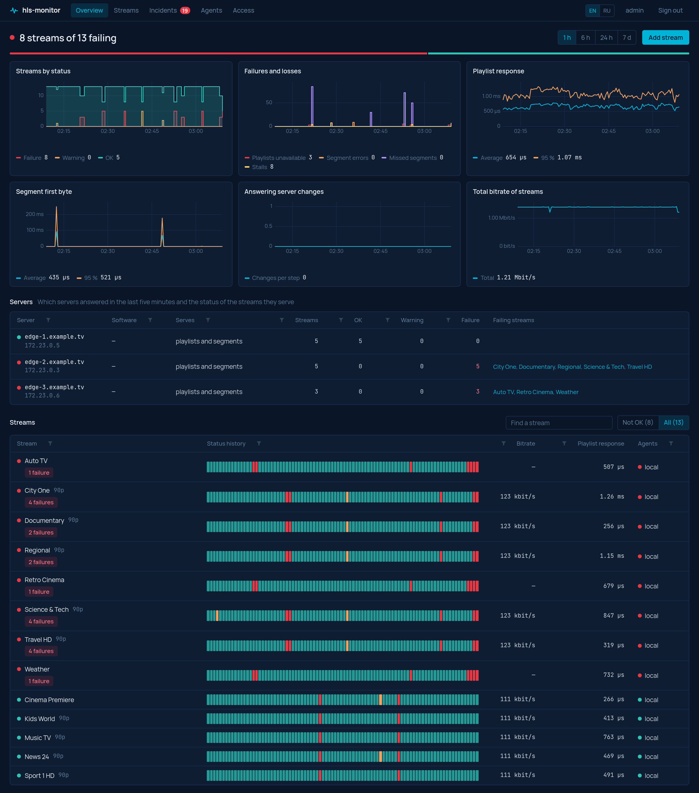
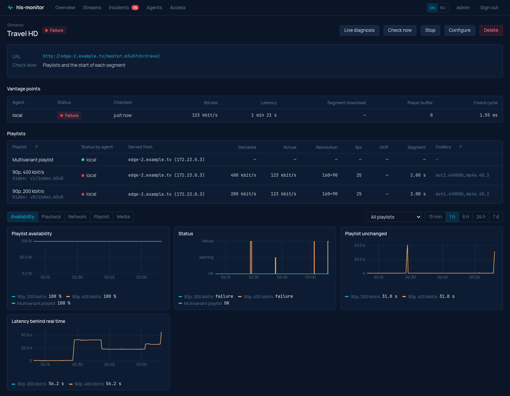
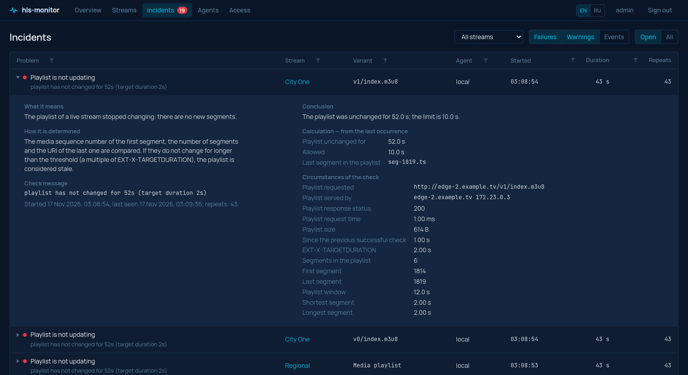

# hls-monitor

English · [Русский](README.ru.md)

> **Proof of concept.** This project was written entirely by Claude, an AI model made by Anthropic, and has not been properly verified. Use it at your own risk.

HLS stream monitoring: a server with a web interface and remote agents that check streams from different points of the network.

The monitor behaves like a player: it reads playlists, downloads every new segment, looks inside MPEG-TS and fMP4, and notices what a viewer would see: unavailability, a stalled playlist, missing segments, slow downloads, timestamp gaps.

The interface is available in English and Russian: the switch is in the top bar, and the default follows the browser language.

## Screenshots

Taken on a demo stand with simulated streams.

Overview: figures over all streams, answering servers and the status history of every stream.



A stream: vantage points, playlists and charts.



An incident with the figures it was concluded from.



A playlist snapshot next to the playlist of the previous check.


Live diagnosis: a separate check every second, shown as it happens.


## Quick start

Docker and Docker Compose are required.

```sh
git clone https://github.com/hotid/hls-monitor.git && cd hls-monitor
cp deploy/.env.example deploy/.env      # optionally set HLSMON_ADMIN_PASSWORD
docker compose -f deploy/docker-compose.yml up -d
```

This runs the published images `ghcr.io/hotid/hls-monitor-server` and VictoriaMetrics; nothing is built. The images are for x86-64 and 64-bit ARM. Of the repository only `deploy/docker-compose.yml` and `deploy/.env` are needed. `HLSMON_VERSION` in `deploy/.env` selects the release (`latest` by default).

The interface opens at <http://localhost:4000>. The port is published on the loopback only: to reach the server from other hosts, set `HLSMON_BIND=0.0.0.0` in `deploy/.env` or put a reverse proxy in front. If the administrator password is not set, it is generated on first start and written to the log once:

```sh
docker compose -f deploy/docker-compose.yml logs server | grep password
```

Save it or change it at once: the line is gone from the log as soon as the container is recreated, for example on an update.

Compose starts two containers: the server and VictoriaMetrics (the time series storage, not published outside). The server container is limited to 3 GB of memory (`HLSMON_MEMORY_LIMIT`); `HLSMON_CPUS` limits its CPU cores, by default it does not.

To update, change `HLSMON_VERSION` (or keep `latest`) and run `docker compose -f deploy/docker-compose.yml pull && docker compose -f deploy/docker-compose.yml up -d`. To build the images from source instead, see [Development](#development).

## What is checked

The depth is set per stream:

| Level | What it does |
|---|---|
| Playlists only | Requests the multivariant and media playlists. Segments are not downloaded. |
| Playlists and the start of each segment | Additionally requests the first 130 KB of every new segment: existence, size, server, video parameters, timestamp continuity. Uses tens of times less traffic than downloading whole segments. |
| Playlists and whole segments | Downloads every new segment: this adds download speed and truncated downloads to the above. Traffic equals the stream bitrate. |
| Playlists, whole segments and media parsing | Additionally parses the whole segment without decoding: duration, GOP, frame rate, errors anywhere in the segment. |

What is collected:

- **Network, per request:** DNS, connect, TLS, time to first byte, total time, speed; response code, redirects, host address, TLS certificate expiry, CDN cache headers, mismatch with `Content-Length`.
- **Multivariant playlist:** the set of variants and its changes, declared bitrate, resolution, codecs; audio and subtitle renditions are checked as separate playlists.
- **Media playlist:** progress of `MEDIA-SEQUENCE` (gaps, rollbacks, replaced segments), update interval and stalling, window depth, durations against `TARGETDURATION`, discontinuities, lag behind real time and jumps by `PROGRAM-DATE-TIME`, availability of encryption keys and the initialization section, ad markers, video variants drifting apart in time (by `PROGRAM-DATE-TIME`; media sequence numbers are not compared, variants may count them independently).
- **Segment:** availability, size, download time relative to duration, actual bitrate against declared.
- **Container (MPEG-TS, fMP4):** sync loss and continuity counter errors, inside a segment and at the joint between two, presence of PAT/PMT, track composition, duration by timestamps against `EXTINF`, timestamp continuity between segments, audio/video offset, starting with a keyframe, GOP length, resolution, profile, frame rate.
- **Player model:** the player buffer of a player running three segments behind the live edge, and the moments when it would stall for buffering.

The interval set for a stream is an upper bound: if the playlist window is shorter, the stream is polled more often so that no segments are missed between checks.

Segments are downloaded once each: every cycle fetches only those that appeared since the previous one. For ended broadcasts and VOD, segments are checked one per cycle, round-robin.

A problem that persists for several cycles becomes an incident. An incident is closed after three clean cycles in a row and no sooner than 30 seconds after the problem was last seen. The playlist text at the moment the problem started is saved.

The details of an incident also say where to look for its cause: whether the other vantage points saw the same problem, and whether other streams served by the same server had it at the same time. It is a guess from that evidence, and is worded as one.

A playlist whose segment numbers do not continue the previous ones (another server behind a balancer with its own numbering answered, or the packager started over) is reported as a change of numbering, not as thousands of lost segments.

### Live diagnosis

A separate check, run once per second at the chosen depth (for one to ten minutes), is started from the stream page. Every check is visible in the browser immediately: the response and server of each playlist, the player model buffer, the video arrival rate as a percentage of real time, every new segment, and everything that was found, with the calculation. The check is performed by the monitor server itself, not by agents. Live diagnosis saves nothing and does not affect regular checks, incidents or charts; no more than three run at the same time.

Decoding (black frame, frozen frame, silence) is not implemented yet.

## Agents

An agent checks streams from its own network and sends the results to the server itself. No incoming connections to the agent are needed. One stream can be checked from several vantage points, which can then be compared.

1. On the "Agents" page, add an agent. The interface shows a one-time token (valid for 24 hours) and a ready-made command.
2. Start the agent on the host you need:

   ```sh
   docker run -d --name hls-monitor-agent --restart unless-stopped \
     -e HLSMON_SERVER_URL=https://monitor.example.com \
     -e HLSMON_ENROLL_TOKEN=<token> \
     -v hls-monitor-agent:/var/lib/hls-monitor \
     ghcr.io/hotid/hls-monitor-agent:latest
   ```

   The address must be the one the server is reached at from the agent host: `localhost` will not do, in a container least of all. Set `HLSMON_PUBLIC_URL` on the server, and `HLSMON_BIND` or a reverse proxy so that the port is reachable. To try an agent on the same machine as the server, run the one built into the server's compose file: `HLSMON_ENROLL_TOKEN=<token> docker compose -f deploy/docker-compose.yml --profile agent up -d agent`.

   The command in the interface already has the server address, the token and the image of the server's version. The same with compose: `deploy/docker-compose.agent.yml`.

3. In the stream settings, select where it should be checked from.

After the first start the agent keeps its key in a volume and no longer needs the token. While the server is unavailable, the agent continues checking and keeps the results on disk, next to its key (up to 1 GB, `HLSMON_QUEUE_MAX_MB`; beyond that the oldest are dropped), then sends them with their original timestamp. The queue survives a restart of the agent; only a power failure may lose its last seconds. Sending a result twice is harmless: the server refuses one that is not newer than what it has stored for the same stream from the same agents. If an agent is silent for more than 90 seconds, its streams are shown as "no data", not as a failure.

To revoke an agent's key, issue it a new token on the "Agents" page.

## Server settings

Every setting is given as a flag or an environment variable.

| Variable | Flag | Default | Purpose |
|---|---|---|---|
| `HLSMON_LISTEN` | `-listen` | `:4000` | Address the server listens on |
| `HLSMON_DB` | `-db` | `data/hls-monitor.db` | SQLite database file |
| `HLSMON_VM_URL` | `-vm-url` | — | VictoriaMetrics address. Without it charts are empty, but state and incidents are still tracked |
| `HLSMON_ADMIN_USER` | `-admin-user` | `admin` | Name of the first administrator |
| `HLSMON_ADMIN_PASSWORD` | `-admin-password` | — | Its password; if empty, it is generated and written to the log |
| `HLSMON_PUBLIC_URL` | `-public-url` | from the request | Server address for agents (shown in the connection instructions) |
| `HLSMON_AGENT_IMAGE` | `-agent-image` | `ghcr.io/hotid/hls-monitor-agent` of the server's version | Agent image named in the connection instructions |
| `HLSMON_BASE_PATH` | `-base-path` | — | URL prefix under which the server is published by a reverse proxy (the proxy must strip it), for example `/hls-monitor` |
| `HLSMON_TRUSTED_PROXIES` | `-trusted-proxies` | — | Addresses of reverse proxies whose `X-Forwarded-For` can be trusted |
| `HLSMON_COOKIE_SECURE` | `-cookie-secure` | `auto` | `Secure` flag of the session cookie: `auto`, `true`, `false` |
| `HLSMON_SESSION_TTL` | `-session-ttl` | `168h` | Session lifetime |
| `HLSMON_SEGMENT_KEEP` | `-segment-keep` | `100` | How many segment journal entries are kept per playlist and agent |
| `HLSMON_SEGMENT_KEEP_PROBLEMS` | `-segment-keep-problems` | `500` | The same for segments with problems; they are counted separately |
| `HLSMON_SEGMENT_RETENTION` | `-segment-retention` | `48h` | Maximum age of a segment journal entry |
| `HLSMON_JOURNAL_MAX_MB` | `-journal-max-mb` | `512` | Size in MiB that the journal file cannot exceed |
| `HLSMON_BODY_MEMORY_MB` | `-body-memory-mb` | `1024` | MiB of segment bodies all local checks together may hold in memory; a download waits when there is no room. The agent has the same setting |
| `HLSMON_SNAPSHOT_RETENTION` | `-snapshot-retention` | `168h` | Retention of playlist snapshots |
| `HLSMON_INCIDENT_RETENTION` | `-incident-retention` | `2160h` | Retention of closed incidents |
| `HLSMON_EVENT_RETENTION` | `-event-retention` | `168h` | Retention of closed events (informational incidents) |
| `HLSMON_LOG_LEVEL` | `-log-level` | `info` | `debug`, `info`, `warn`, `error` |

Retention of time series is set in VictoriaMetrics (`HLSMON_METRICS_RETENTION` in compose, 7 days by default, the same as the longest chart range).

Agent settings: `HLSMON_SERVER_URL`, `HLSMON_ENROLL_TOKEN`, `HLSMON_KEY_FILE` (`data/agent.key` by default; in the container it is in a volume), `HLSMON_QUEUE_DIR` (undelivered results; `queue` next to the key by default), `HLSMON_QUEUE_MAX_MB` (`1024`), `HLSMON_BODY_MEMORY_MB`, `HLSMON_LOG_LEVEL`.

The server does not terminate TLS itself: put a reverse proxy in front of it and specify the proxy's address in `HLSMON_TRUSTED_PROXIES`.

An nginx example for a server published under a prefix (`HLSMON_BASE_PATH=/hls-monitor`):

```nginx
location = /hls-monitor { return 301 /hls-monitor/; }
location /hls-monitor/ {
    proxy_pass http://127.0.0.1:4000/;          # the trailing slash strips the prefix
    proxy_set_header Host $host;
    proxy_set_header X-Forwarded-For $proxy_add_x_forwarded_for;
    proxy_set_header X-Forwarded-Proto $scheme;
    client_max_body_size 64m;                   # batches of results from agents
}
```

## Users

There are two roles: an administrator changes streams, agents and access; a viewer sees dashboards and history. The values of request headers set for a stream are shown only to administrators. The headers are sent only to the site of the stream URL (the same host, or names under the same registrable domain): a playlist or a redirect that points elsewhere does not get them.

## API

All requests are described in Swagger UI at `/swagger/index.html` (after signing in).

- `/api/v1` — the web interface API. Authorization is by session cookie; every request except GET must carry the `X-Requested-With` header.
- `/api/agent/v1` — the agent protocol.
- `/api/ext/v1` — a read-only API for external monitoring systems. Tokens are created on the "Access" page.

### Zabbix and other systems

```sh
curl -H "Authorization: Bearer <token>" http://localhost:4000/api/ext/v1/status
```

| Request | What it returns |
|---|---|
| `GET /api/ext/v1/discovery/streams` | List of streams for low-level discovery |
| `GET /api/ext/v1/discovery/variants` | Active playlists of all streams |
| `GET /api/ext/v1/discovery/agents` | Agents and their availability |
| `GET /api/ext/v1/status` | Current state of all streams |
| `GET /api/ext/v1/streams/{id}/status` | State of one stream with per-playlist metrics; convenient as a master item with dependent items |

`status_code`: 0 — OK, 1 — warning, 2 — failure, 3 — no data, −1 — disabled. There is no ready-made Zabbix template in the repository.

Time series names in VictoriaMetrics start with `hls_`; the labels are `stream`, `agent`, `variant` (identifiers).

### Watching the monitor itself

| Address | What it gives |
|---|---|
| `GET /healthz` | The process is alive |
| `GET /readyz` | Readiness: 503 when the database does not answer; otherwise 200 and the state by part — database, time series storage, load, whether checks are on time (`ok` or `degraded`) |
| `GET /metrics` | Figures of the server itself and of the agents in the Prometheus format. Needs the same token as `/api/ext/v1` |

`/metrics` has: processor use and its limit, throttling, wake-up delay, memory, how many streams are checked and how many of them late, how many results were stored and lost, the size of the database and the journal, and for every agent whether it is in contact, whether it is overloaded, how many results wait in its queue, for how long, and how many it dropped.

**Overload.** A monitor short of processor time measures its own delay, not the stream's. The server and the agent watch themselves: the process asks to be woken every 50 ms and looks at how late that happens — the same delay is added to everything it measures. When one wake-up in ten is more than 100 ms late, or one goroutine in a hundred that is ready to run waits longer than that for a processor, a check counts as made under overload. In such a check the findings that rest on timing alone — a slow segment, a playback stall, segments missed between checks, request timeouts — are not raised, and incidents already open are not closed: there is no evidence either way. Errors seen directly (HTTP 404, a broken container) are reported as usual. The overload is shown in the status bar of the interface, on the Agents page, in `/readyz` and in `/metrics`. A shortage of network capacity the monitor cannot recognise.

## Development

Go 1.26 and Node.js 22 are required.

```sh
make web      # build the interface and put it where it is embedded into the server from
make build    # bin/hls-monitor-server and bin/hls-monitor-agent
make test     # Go tests, interface type checking and translation check
make swagger  # regenerate the API specification after changing annotations
```

Without `make web` the server builds and runs, but serves a placeholder instead of the interface.

To run in Docker from the source tree instead of the published images, add `docker-compose.build.yml`:

```sh
docker compose -f deploy/docker-compose.yml -f deploy/docker-compose.build.yml up -d --build
```

Always rebuild through compose with `up -d --build`: it does not use an image built by hand under a different tag. An agent image alone: `docker build -f deploy/Dockerfile --target agent -t hls-monitor-agent .`

For manual testing there is a live stream simulator with controllable faults:

```sh
go run ./cmd/hls-fake-origin -listen :8089        # http://localhost:8089/master.m3u8
curl 'http://localhost:8089/ctl/freeze?on=1'      # the playlist stops updating
curl 'http://localhost:8089/ctl/fail?status=404'  # the next segment returns 404
```

The full list of commands is in the comment at the top of `cmd/hls-fake-origin/main.go`.

The interface in development mode: start the server, then run `cd web && HLSMON_API=http://127.0.0.1:4000 npm run dev`.

Interface texts live in `web/src/locales/<language>/`; a new language is a new folder there. See [web/I18N.md](web/I18N.md).

### Layout

| Directory | Contents |
|---|---|
| `cmd/` | Entry points: server, agent, stream simulator |
| `internal/probe` | Check engine for a single stream |
| `internal/media` | MPEG-TS and fMP4 parsing |
| `internal/httpx` | HTTP client with timing measurements |
| `internal/runner` | Check loops over the list of streams |
| `internal/ingest` | Ingestion of results: series, journal, state, incidents |
| `internal/store` | SQLite: settings, state, incidents, segment journal |
| `internal/metrics` | VictoriaMetrics client |
| `internal/api` | HTTP API |
| `internal/agent`, `internal/agentproto` | The agent and its protocol |
| `internal/hlstest` | Stream simulator for tests |
| `web/` | Interface: Vue 3, TypeScript |
| `deploy/` | Dockerfile and compose files |
