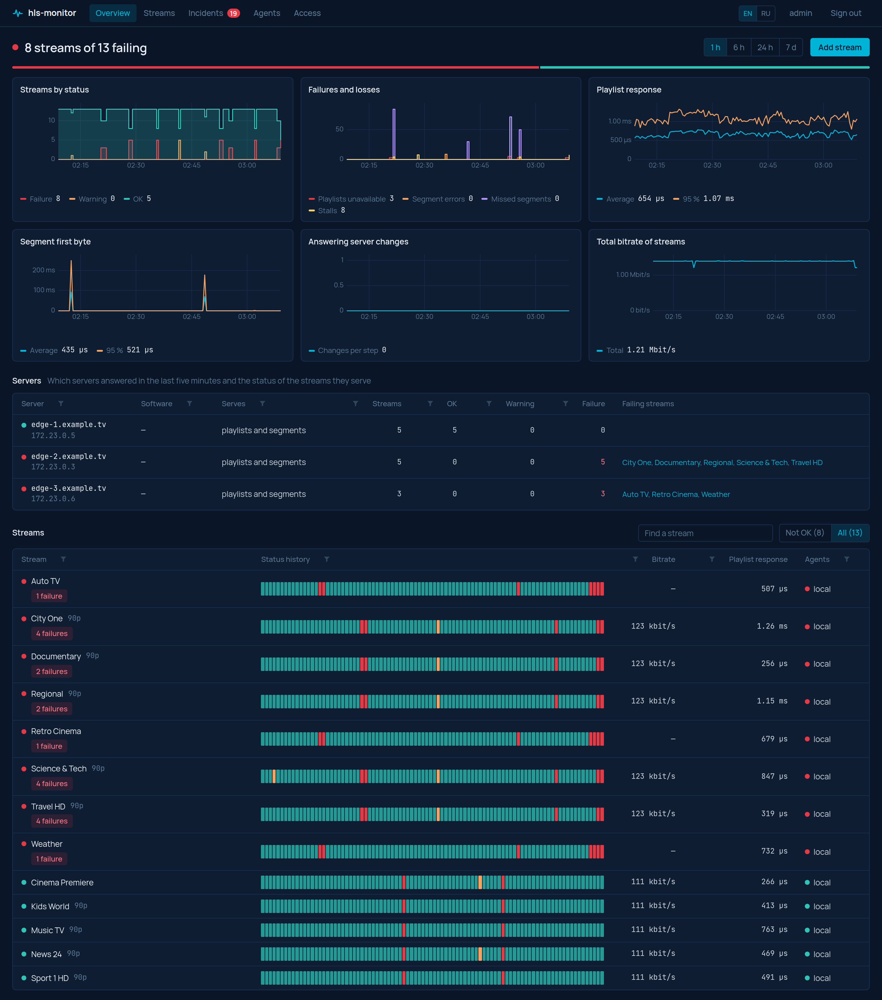
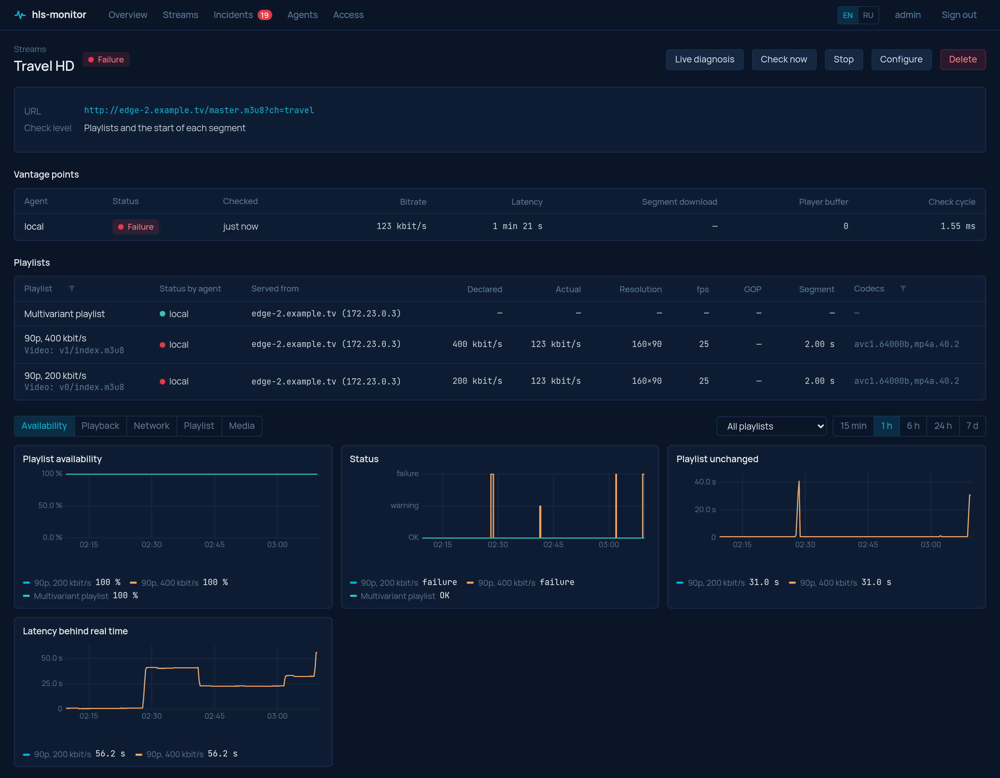
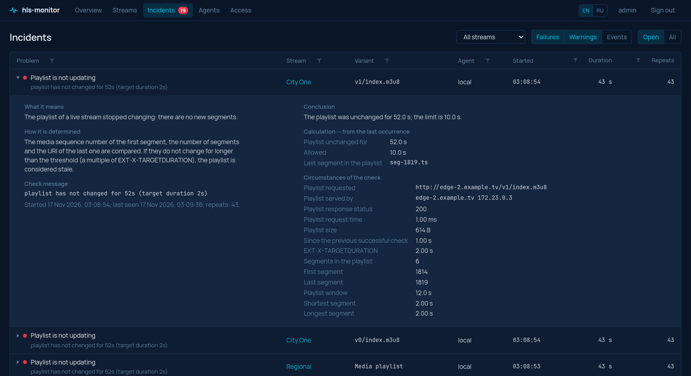
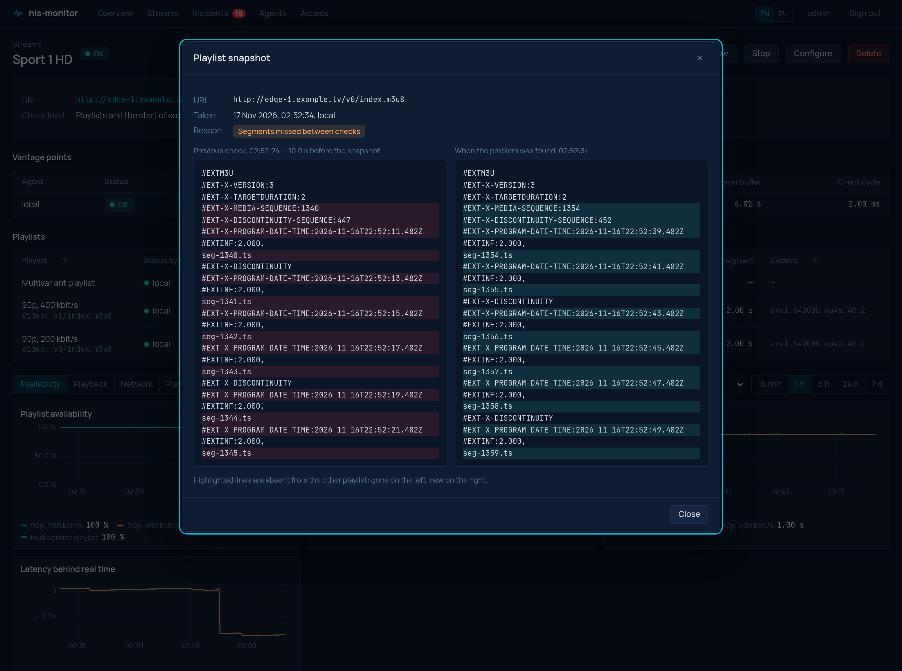
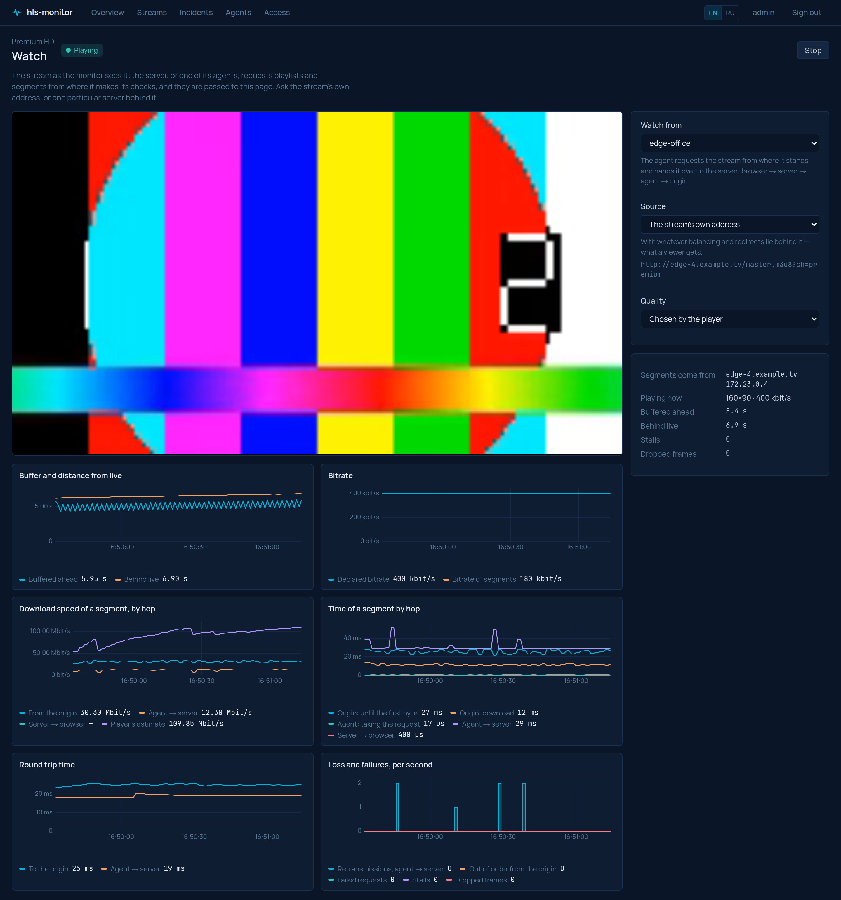
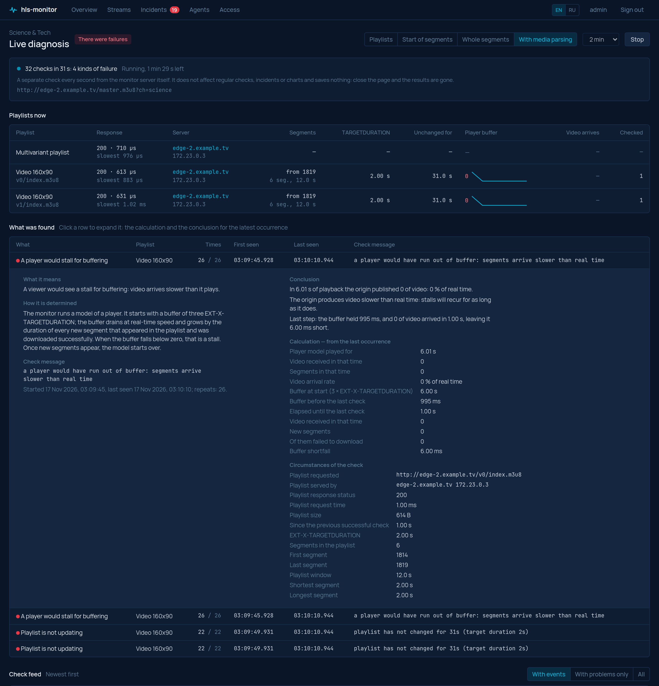

# hls-monitor

[English](README.md) · Русский

> **Proof of concept.** Проект полностью написан Claude, ИИ-моделью Anthropic, и толком не проверен — используйте на свой страх и риск.

Мониторинг HLS-потоков: сервер с веб-интерфейсом и удалённые агенты, которые проверяют потоки из разных точек сети.

Монитор ведёт себя как плеер: читает плейлисты, скачивает каждый новый сегмент, заглядывает внутрь MPEG-TS и fMP4 — и замечает то, что увидел бы зритель: недоступность, зависший плейлист, пропавшие сегменты, медленную загрузку, разрывы временных меток.

Интерфейс доступен на английском и русском языках: переключатель — в верхней панели, по умолчанию язык выбирается по языку браузера.

## Возможности

- **Проверки четырёх уровней глубины, уровень задаётся для каждого потока:** только плейлисты; первые килобайты каждого сегмента; сегменты целиком; сегменты целиком с разбором контейнера. Самый дешёвый полезный уровень стоит несколько процентов от битрейта потока.
- **Разбор медиа без декодирования:** MPEG-TS и fMP4 — счётчики непрерывности, таблицы, дорожки, метки времени, кадры и ключевые кадры, GOP, частота кадров; H.264, HEVC и MPEG-2, включая чересстрочное. Сверено с ffprobe на реальных эфирных сегментах.
- **Инциденты с доказательствами:** у каждой находки сохраняются цифры, из которых сделан вывод, плейлист в момент проблемы и на предыдущей проверке, пройденные редиректы и ответивший сервер.
- **Где искать причину:** видели ли то же другие точки наблюдения и есть ли проблема у других потоков того же сервера. Одна и та же проблема у нескольких потоков сервера сразу — один инцидент сервера, а не по одному на поток; проблема, вернувшаяся через несколько минут, продолжает свой инцидент.
- **Сеть по серверам:** RTT, потери и доля запросов по каждому отвечающему серверу, время редиректов балансировщика и установление соединения, измеренное на соединении, открытом нарочно.
- **Просмотр через монитор:** плеер на странице потока, которому поток отдаёт сервер или агент — браузер → сервер → агент → стример, — с выбором конкретного сервера за балансировщиком и графиками по каждому участку: скорость, задержка, RTT и доля потерянных пакетов.
- **Смотрит на картинку, если попросить:** чёрный кадр, застывшая картинка и тишина находятся декодированием одного кадра и небольшого куска звука каждого потока раз в несколько минут; последний кадр виден на странице потока.
- **Диагностика вживую:** отдельная проверка раз в секунду, результат виден сразу.
- **Агенты в других сетях:** делают только исходящие соединения, копят результаты на диске, пока сервер недоступен, и сообщают состояние своего канала до сервера.
- **Знает, когда не справляется сам:** перегруженный монитор не выдаёт собственную задержку за сбой потоков и догоняет, а не отстаёт дальше.
- **Осторожен с тем, на что его направили:** поток с публичным адресом не уведёт монитор в его собственную сеть; заголовки потока с токенами уходят только на сайт самого потока; плейлист, роняющий разборщик, — находка, а не падение.
- **Собственное здоровье:** `/readyz`, `/metrics` в формате Prometheus, шаблон Zabbix; ряды переживают простой VictoriaMetrics в очереди на диске.
- **Графики, которые можно читать:** клик по подписи в легенде оставляет одну линию, Ctrl или Shift добавляет ещё, наведение на подпись выделяет её линию.
- **Интерфейс на русском и английском,** API с описанием в Swagger, пользователи с двумя ролями.

## Скриншоты

Сняты на демо-стенде с имитацией потоков, интерфейс на английском. Интерфейс меняется быстрее картинок: они могут немного отставать от того, что вы увидите.

Обзор: показатели по всем потокам, отвечающие серверы и история состояния каждого потока.



Поток: точки наблюдения, плейлисты и графики.



Инцидент с цифрами, из которых сделан вывод.



Снимок плейлиста рядом с плейлистом предыдущей проверки.



Просмотр потока через агента, с графиками по каждому участку пути.



Диагностика вживую: отдельная проверка раз в секунду, результат виден сразу.



## Быстрый старт

Нужны Docker и Docker Compose.

```sh
git clone https://github.com/hotid/hls-monitor.git && cd hls-monitor
cp deploy/.env.example deploy/.env      # при желании задайте HLSMON_ADMIN_PASSWORD
docker compose -f deploy/docker-compose.yml up -d
```

Запускаются опубликованные образы `ghcr.io/hotid/hls-monitor-server` и VictoriaMetrics, ничего не собирается. Образы есть под x86-64 и 64-битный ARM. Из репозитория нужны только `deploy/docker-compose.yml` и `deploy/.env`. Версию выбирает `HLSMON_VERSION` в `deploy/.env` (по умолчанию `latest`).

Интерфейс откроется на <http://localhost:4000>. Порт публикуется только на локальном адресе: чтобы сервер был доступен с других машин, задайте `HLSMON_BIND=0.0.0.0` в `deploy/.env` или поставьте перед ним обратный прокси. Если пароль администратора не задан, он генерируется при первом запуске и один раз пишется в лог:

```sh
docker compose -f deploy/docker-compose.yml logs server | grep password
```

Сохраните его или сразу смените: строка исчезнет из лога, как только контейнер будет пересоздан, например при обновлении.

Compose поднимает два контейнера: сервер и VictoriaMetrics (хранилище числовых рядов, наружу не публикуется). Контейнеру сервера отведено 3 ГБ памяти (`HLSMON_MEMORY_LIMIT`); `HLSMON_CPUS` ограничивает число ядер, по умолчанию ограничения нет.

Чтобы обновиться, поменяйте `HLSMON_VERSION` (или оставьте `latest`) и выполните `docker compose -f deploy/docker-compose.yml pull && docker compose -f deploy/docker-compose.yml up -d`. Как собрать образы из исходников — в разделе [Разработка](#разработка).

## Что проверяется

Глубина задаётся для каждого потока:

| Уровень | Что делает |
|---|---|
| Только плейлисты | Запрашивает мастер- и медиа-плейлисты. Сегменты не скачиваются. |
| Плейлисты и начало каждого сегмента | Дополнительно запрашивает первые 130 КБ каждого нового сегмента: существование, размер, сервер, параметры видео, стыковка временных меток. Трафика в десятки раз меньше, чем при загрузке целиком. |
| Плейлисты и сегменты целиком | Скачивает каждый новый сегмент: к перечисленному добавляются скорость загрузки и обрывы. Трафик равен битрейту потока. |
| Плейлисты, сегменты целиком и разбор медиа | Дополнительно разбирает весь сегмент без декодирования: длительность, GOP, частота кадров, ошибки в любом месте. |

Что собирается:

- **Сеть, по каждому запросу:** DNS, соединение, TLS, время до первого байта, полное время, скорость; код ответа, редиректы, адрес узла, срок TLS-сертификата, заголовки кэша CDN, расхождение с `Content-Length`. На Linux ещё и то, что знает о соединении ядро: время туда-обратно до сервера и пакеты, пришедшие не по порядку, — признак потерь на пути к монитору (сосчитать сами потери может только отправитель). То же хранится по серверам — время туда-обратно, повторные передачи на запрос, доля запросов, на которые отвечает каждый, — потому что потери и задержка относятся к пути до сервера больше, чем к одному потоку. Соединения между проверками не закрываются, поэтому раз в пять минут каждый поток запрашивается на соединении, открытом нарочно: отсюда время поиска имени, соединения и TLS. Запрос по адресу потока замеряется вместе с редиректами: это работа балансировщика.
- **Мастер-плейлист:** набор вариантов и его изменения, заявленные битрейт, разрешение, кодеки; аудио- и субтитровые дорожки проверяются как отдельные плейлисты.
- **Медиа-плейлист:** ход `MEDIA-SEQUENCE` (пропуски, откаты, подмена сегментов), интервал обновления и «зависание», глубина окна, длительности против `TARGETDURATION`, разрывы, отставание от реального времени и скачки по `PROGRAM-DATE-TIME`, доступность ключей шифрования и секции инициализации, рекламные метки, расхождение видеовариантов во времени (по `PROGRAM-DATE-TIME`; номера сегментов не сравниваются — варианты вправе нумеровать их независимо).
- **Сегмент:** доступность, размер, время загрузки относительно длительности, фактический битрейт против заявленного.
- **Контейнер (MPEG-TS, fMP4):** потеря синхронизации и ошибки счётчика непрерывности, внутри сегмента и на стыке двух, наличие PAT/PMT, состав дорожек, длительность по временным меткам против `EXTINF`, стыковка меток между сегментами, сдвиг аудио и видео, начало с ключевого кадра, длина GOP, разрешение, профиль, частота кадров.
- **Модель плеера:** запас буфера у плеера, идущего в трёх сегментах от края трансляции, и моменты, когда он остановился бы на буферизацию.

Интервал, заданный для потока, — это верхняя граница: если окно плейлиста короче, поток опрашивается чаще, чтобы не пропустить сегменты между проверками.

Сегменты скачиваются по одному разу: в каждом цикле — только появившиеся с прошлого. Для завершённых трансляций и VOD сегменты проверяются по одному за цикл, по кругу.

Проблема, которая держится несколько циклов, становится инцидентом. Инцидент закрывается после трёх чистых циклов подряд и не раньше чем через 30 секунд после последнего проявления. Текст плейлиста на момент начала проблемы сохраняется. Проблема, вернувшаяся в течение десяти минут после окончания, продолжает тот же инцидент: он говорит, сколько раз она начиналась, а длительность считается без пауз. Когда у трёх и более потоков одного сервера одновременно одна и та же проблема с ответом — ошибка HTTP, недоступный или застывший плейлист, сбои сегментов, — это инцидент сервера: одна строка со списком потоков вместо строки на каждый; инцидентом сервера считается и путь, на котором больше 5 % запросов потребовали повторной передачи TCP.

В подробностях инцидента сказано и то, где искать причину: видели ли ту же проблему другие точки проверки и была ли она в то же время на других потоках с того же сервера. Это предположение по этим признакам, так оно и сформулировано.

Плейлист, номера сегментов которого не продолжают прежние (ответил другой сервер за балансировщиком со своей нумерацией или упаковщик начал счёт заново), отмечается как смена нумерации, а не как тысячи потерянных сегментов.

### Просмотр

Со страницы потока его можно посмотреть — через сам монитор: сервер запрашивает плейлисты и сегменты оттуда же, откуда делает проверки, и передаёт их в браузер, так что видно ровно то, что видит монитор. Источник выбирается: собственный адрес потока, со всей балансировкой за ним, или один конкретный сервер напрямую — из тех, что отвечали по этому потоку, и остальных серверов того же сайта. Качество и звуковая дорожка выбираются в плеере. Рядом с видео показано, какой сервер отдаёт сегменты, сколько загружено вперёд, отставание от эфира, остановки и ошибки загрузки.

Под видео — графики за сеанс просмотра (последние десять минут, только в браузере, никуда не пишутся), с разбивкой по участкам пути: буфер и отставание от эфира; заявленный и фактический битрейт и скорость на каждом участке; куда уходит время получения сегмента — ожидание и загрузка у стримера, путь от агента до сервера, путь от сервера до браузера; время туда-обратно до стримера и между агентом и сервером; потери и сбои. Про потери: повторные передачи TCP между агентом и сервером считает агент, потому что он отправляет, — это настоящие потери. От стримера монитор только принимает, поэтому потери на том пути видны как пакеты, пришедшие не по порядку: это признак потерь, а не их счёт. Цифры ядра о соединениях читаются только на Linux. Те же замеры по каждому ответу сервер отдаёт в заголовках `Server-Timing` и `X-Fetch-Info`. Рисуется и RTT между браузером и сервером, и потери как доля пакетов по каждому участку, где можно спросить отправителя: точка наблюдения — на своих запросах к стримеру, агент — на пути к серверу, сервер — на пути к браузеру (не за прокси: там он видит соединение прокси).

Браузер получает только подписанные сервером адреса, действующие двенадцать часов: запросить через монитор произвольный адрес нельзя. Весь трафик просмотра идёт через сервер (а при просмотре через агента — ещё и через него); ограничения на число зрителей нет. Играет то, что умеет декодировать браузер: H.264 с AAC — везде, MPEG-2, AC-3 и HEVC — как повезёт. Смотреть можно и через агента: тогда поток запрашивает агент из своей сети, а путь выглядит как браузер → сервер → агент → источник. Входящих соединений агенту для этого не нужно: он сам держит открытыми несколько запросов к серверу и получает работу как ответы на них.

### Диагностика вживую

Со страницы потока запускается отдельная проверка раз в секунду на выбранной глубине (от одной до десяти минут). Каждая проверка сразу видна в браузере: ответ и сервер каждого плейлиста, запас модели плеера, скорость поступления видео в процентах от реального времени, каждый новый сегмент и всё, что найдено, с расчётом. Проверяет сам сервер монитора, а не агенты. Диагностика ничего не сохраняет и не влияет на обычные проверки, инциденты и графики; одновременно идёт не больше трёх.

### Картинка и звук

Поток, у которого плейлисты и сегменты в порядке, может показывать чёрный экран, застывшую картинку или молчать. Если задать `HLSMON_PICTURE_CHECK` (например `5m`), на каждый поток раз в этот срок смотрят: декодируется один ключевой кадр сегмента и пара секунд его звука, и монитор отмечает, насколько кадр яркий, тот ли он, что при прошлом замере, и насколько громок звук. Один тёмный кадр или одна пауза ничего не значат, поэтому после подозрительного замера монитор смотрит снова через 20 секунд, а о чёрном кадре, неменяющейся картинке или тишине сообщает, когда то же самое видно три замера подряд и не меньше минуты. Последний кадр показан на странице потока, а у инцидента хранится кадр, на котором он замечен в последний раз.

Декодирует ffmpeg, который лежит в образах и запускается отдельной программой: ему даётся сегмент на вход и больше ничего — ни файлов, ни сети, — с ограничением времени и памяти. Сегмент, который он не смог декодировать, — не находка. Замеры откладываются, пока монитор не успевает.

**Заглушки.** То, что оператор ставит в эфир вместо канала, — «трансляция прервана по техническим причинам» — не чёрный кадр и, если оно движется, не стоп-кадр. Администратор, увидев такую картинку, помечает её кнопкой «Это заглушка» на странице потока или в инциденте и даёт ей название; после этого поток, который её показывает, получает сбой «Заглушка вместо эфира» при первом же замере, с этим названием, а агенты узнают о заглушках вместе с конфигурацией. Заглушка с часами или мигающим значком всё равно узнаётся. Та, что представляет собой целый ролик по кругу, требует кадра с каждого места, на котором её застали: пометьте её ещё раз под тем же названием. Список заглушек и их удаление — на странице «Настройки».

Чего это не делает: между замерами картинка не видна, поэтому чёрный экран короче периода можно пропустить; зашифрованные потоки и потоки уровня «только плейлисты» не смотрятся. Потоку, который показывает неподвижную картинку по замыслу — радио, тест-таблица, — это можно указать в настройках, или не смотреть на него вовсе. Один замер стоит около десятой доли секунды процессора; на уровне «начало каждого сегмента» он ещё и скачивает до 512 КБ одного сегмента вместо 130.

## Агенты

Агент проверяет потоки из своей сети и сам передаёт результаты на сервер. Входящие соединения к агенту не нужны. Один поток можно проверять из нескольких точек и сравнивать их.

1. На странице «Агенты» добавьте агента. Интерфейс покажет одноразовый токен (действует 24 часа) и готовую команду.
2. Запустите агента на нужном хосте:

   ```sh
   docker run -d --name hls-monitor-agent --restart unless-stopped \
     -e HLSMON_SERVER_URL=https://monitor.example.com \
     -e HLSMON_ENROLL_TOKEN=<токен> \
     -v hls-monitor-agent:/var/lib/hls-monitor \
     ghcr.io/hotid/hls-monitor-agent:latest
   ```

   Адрес должен быть тем, по которому сервер доступен с хоста агента: `localhost` не подойдёт, тем более из контейнера. Задайте серверу `HLSMON_PUBLIC_URL`, а чтобы порт был доступен — `HLSMON_BIND` или обратный прокси. Чтобы попробовать агента на той же машине, что и сервер, запустите встроенного в compose-файл сервера: `HLSMON_ENROLL_TOKEN=<токен> docker compose -f deploy/docker-compose.yml --profile agent up -d agent`.

   В команде из интерфейса уже подставлены адрес сервера, токен и образ той же версии, что у сервера. То же через compose: `deploy/docker-compose.agent.yml`.

3. В настройках потока отметьте, откуда его проверять.

После первого запуска агент хранит свой ключ в томе, и токен ему больше не нужен. Пока сервер недоступен, агент продолжает проверки и хранит результаты на диске рядом с ключом (до 1 ГБ, `HLSMON_QUEUE_MAX_MB`; сверх этого удаляются самые старые), затем досылает их с исходным временем. Очередь переживает перезапуск агента; потерять её последние секунды может только отключение питания. Повторная отправка результата безвредна: сервер не принимает результат, который не новее уже сохранённого для того же потока от того же агента. Если агент молчит дольше 90 секунд, его потоки показываются как «нет данных», а не как сбой.

Чтобы отозвать ключ агента, выдайте ему новый токен на странице «Агенты».

## Настройки сервера

Каждая настройка задаётся флагом или переменной окружения.

| Переменная | Флаг | По умолчанию | Назначение |
|---|---|---|---|
| `HLSMON_LISTEN` | `-listen` | `:4000` | Адрес, на котором слушает сервер |
| `HLSMON_DB` | `-db` | `data/hls-monitor.db` | Файл базы SQLite |
| `HLSMON_VM_URL` | `-vm-url` | — | Адрес VictoriaMetrics. Без него графики пусты, но состояние и инциденты ведутся |
| `HLSMON_ADMIN_USER` | `-admin-user` | `admin` | Имя первого администратора |
| `HLSMON_ADMIN_PASSWORD` | `-admin-password` | — | Его пароль; если пуст, генерируется и пишется в лог |
| `HLSMON_PUBLIC_URL` | `-public-url` | из запроса | Адрес сервера для агентов (показывается в инструкции подключения) |
| `HLSMON_AGENT_IMAGE` | `-agent-image` | `ghcr.io/hotid/hls-monitor-agent` той же версии, что сервер | Образ агента в инструкции подключения |
| `HLSMON_BASE_PATH` | `-base-path` | — | Префикс адреса, под которым сервер опубликован обратным прокси (прокси должен его срезать), например `/hls-monitor` |
| `HLSMON_TRUSTED_PROXIES` | `-trusted-proxies` | — | Адреса обратных прокси, чьему `X-Forwarded-For` можно верить |
| `HLSMON_COOKIE_SECURE` | `-cookie-secure` | `auto` | Флаг `Secure` у cookie сеанса: `auto`, `true`, `false` |
| `HLSMON_SESSION_TTL` | `-session-ttl` | `168h` | Срок жизни сеанса |
| `HLSMON_SEGMENT_KEEP` | `-segment-keep` | `100` | Сколько записей журнала сегментов хранится на плейлист и агента |
| `HLSMON_SEGMENT_KEEP_PROBLEMS` | `-segment-keep-problems` | `500` | То же для сегментов с проблемами — они считаются отдельно |
| `HLSMON_SEGMENT_RETENTION` | `-segment-retention` | `48h` | Предельный возраст записи журнала сегментов |
| `HLSMON_JOURNAL_MAX_MB` | `-journal-max-mb` | `512` | Размер в МиБ, который файл журнала не может превысить |
| `HLSMON_BODY_MEMORY_MB` | `-body-memory-mb` | `1024` | Сколько МиБ тел сегментов все локальные проверки вместе могут держать в памяти; при нехватке загрузка ждёт. У агента та же настройка |
| `HLSMON_PRIVATE_NETWORKS` | `-private-networks` | `same` | Можно ли проверкам соединяться с непубличными адресами (loopback, частные, link-local, операторские и контейнерные диапазоны). `same`: только для потока, чей собственный адрес такой, — поток с публичным адресом не уведёт монитор внутрь ни редиректом, ни тем, что названо в его плейлистах; `allow`: без ограничений; `deny`: никогда. Проверяется адрес, с которым реально устанавливается соединение, после разрешения имени; при работе через прокси не применяется. У агента та же настройка |
| `HLSMON_METRICS_QUEUE_MAX_MB` | `-metrics-queue-max-mb` | `1024` | Сколько МиБ диска отведено значениям, которые VictoriaMetrics ещё не приняла. Пока она недоступна и при перезапусках сервера они лежат сжатыми (примерно в двенадцать раз) в `metrics-queue` рядом с базой и записываются с исходным временем, когда она возвращается; сверх лимита удаляются самые старые |
| `HLSMON_SNAPSHOT_RETENTION` | `-snapshot-retention` | `168h` | Срок хранения снимков плейлистов |
| `HLSMON_INCIDENT_RETENTION` | `-incident-retention` | `2160h` | Срок хранения закрытых инцидентов |
| `HLSMON_EVENT_RETENTION` | `-event-retention` | `168h` | Срок хранения закрытых событий (информационных инцидентов) |
| `HLSMON_PICTURE_CHECK` | `-picture-check` | — | Как часто смотреть на картинку и слушать звук каждого потока, например `5m`; пусто — не смотреть. У агента такая же настройка |
| `HLSMON_FFMPEG` | `-ffmpeg` | `ffmpeg` | Программа ffmpeg, которой декодируют замеры |
| `HLSMON_LOG_LEVEL` | `-log-level` | `info` | `debug`, `info`, `warn`, `error` |

Срок хранения числовых рядов задаётся в VictoriaMetrics (`HLSMON_METRICS_RETENTION` в compose, по умолчанию 7 дней — столько же, сколько самый длинный диапазон графиков).

Настройки агента: `HLSMON_SERVER_URL`, `HLSMON_ENROLL_TOKEN`, `HLSMON_KEY_FILE` (по умолчанию `data/agent.key`, в контейнере — в томе), `HLSMON_QUEUE_DIR` (недоставленные результаты; по умолчанию `queue` рядом с ключом), `HLSMON_QUEUE_MAX_MB` (`1024`), `HLSMON_BODY_MEMORY_MB`, `HLSMON_PRIVATE_NETWORKS`, `HLSMON_LOG_LEVEL`.

TLS сервер сам не терминирует: ставьте перед ним обратный прокси и укажите его адрес в `HLSMON_TRUSTED_PROXIES`.

Пример для nginx, если сервер публикуется под префиксом (`HLSMON_BASE_PATH=/hls-monitor`):

```nginx
location = /hls-monitor { return 301 /hls-monitor/; }
location /hls-monitor/ {
    proxy_pass http://127.0.0.1:4000/;          # косая черта в конце срезает префикс
    proxy_set_header Host $host;
    proxy_set_header X-Forwarded-For $proxy_add_x_forwarded_for;
    proxy_set_header X-Forwarded-Proto $scheme;
    client_max_body_size 64m;                   # пачки результатов от агентов
}
```

## Резервная копия

Всё, что настроено, лежит в томе сервера: `hls-monitor.db` (потоки, пользователи, токены, ключи агентов, инциденты) и `hls-monitor-journal.db` (журнал сегментов, восстанавливать не обязательно). База работает в режиме WAL, поэтому копировать файл у работающего сервера нельзя: копия может оказаться несогласованной. Остановите сервер на несколько секунд — агенты в это время копят результаты у себя и дошлют их:

```sh
docker compose stop server
docker run --rm -v hls-monitor_server-data:/data:ro -v "$PWD":/backup alpine tar czf /backup/hls-monitor-data.tgz -C /data .
docker compose start server
```

Восстановление — на пустой том, при остановленном сервере:

```sh
docker run --rm -v hls-monitor_server-data:/data -v "$PWD":/backup:ro alpine tar xzf /backup/hls-monitor-data.tgz -C /data
```

Числовые ряды живут в томе VictoriaMetrics и в копию не входят; без них пропадут только графики за прошлое. Их копия делается [средствами VictoriaMetrics](https://docs.victoriametrics.com/victoriametrics/single-server-victoriametrics/#how-to-work-with-snapshots).

## Пользователи

Две роли: администратор меняет потоки, агентов и доступ; роль «только просмотр» видит дашборды и историю. Значения заголовков запросов, заданных для потока, показываются только администраторам. Заголовки отправляются только на сайт адреса потока (тот же хост или имена в том же регистрируемом домене): плейлист или редирект, ведущий в другое место, их не получает.

## API

Описание всех запросов — в Swagger UI на `/swagger/index.html` (после входа).

- `/api/v1` — API веб-интерфейса. Авторизация — cookie сеанса; каждый запрос, кроме GET, должен нести заголовок `X-Requested-With`.
- `/api/agent/v1` — протокол агентов.
- `/api/ext/v1` — API только на чтение для внешних систем мониторинга. Токены создаются на странице «Настройки».

### Zabbix и другие системы

```sh
curl -H "Authorization: Bearer <токен>" http://localhost:4000/api/ext/v1/status
```

| Запрос | Что возвращает |
|---|---|
| `GET /api/ext/v1/discovery/streams` | Список потоков для низкоуровневого обнаружения |
| `GET /api/ext/v1/discovery/variants` | Активные плейлисты всех потоков |
| `GET /api/ext/v1/discovery/agents` | Агенты и их доступность |
| `GET /api/ext/v1/status` | Текущее состояние всех потоков |
| `GET /api/ext/v1/streams/{id}/status` | Состояние одного потока с метриками по плейлистам — удобно как мастер-элемент с зависимыми элементами |

`status_code`: 0 — в порядке, 1 — предупреждение, 2 — сбой, 3 — нет данных, −1 — выключен.

Готовый шаблон для Zabbix 7.2 и новее — [`deploy/zabbix/template_hls_monitor.yaml`](deploy/zabbix/template_hls_monitor.yaml), «HLS monitor by HTTP». Он работает без агента Zabbix: импортируйте шаблон, привяжите его к узлу и задайте макросы `{$HLSMON.URL}` (адрес сервера с префиксом, без косой черты в конце) и `{$HLSMON.TOKEN}` (токен со страницы «Доступ»). Шаблон делает три запроса в минуту — `/readyz`, `/metrics` и `/api/ext/v1/status` — и из них получает:

- по каждому потоку (обнаружение): состояние и число открытых инцидентов; триггеры «сбой» (3 мин), «нет данных» (5 мин), «предупреждение» (15 мин). Если сбоит больше `{$HLSMON.MASS.FAIL}` потоков сразу, срабатывает один общий триггер, а потоковые от него зависят;
- по самому монитору: не отвечает, не может работать (база), перегружен, проверки опаздывают, результаты не сохраняются, хранилище рядов недоступно, диск почти заполнен;
- по каждому агенту (обнаружение): не на связи, перегружен, результаты не доставляются, очередь переполнилась, не может писать в очередь, канал до сервера медленный, теряет пакеты или запросы по нему не проходят.

Сроки и пороги — в макросах шаблона.

Имена числовых рядов в VictoriaMetrics начинаются с `hls_`, метки — `stream`, `agent`, `variant` (идентификаторы).

### Наблюдение за самим монитором

| Адрес | Что отдаёт |
|---|---|
| `GET /healthz` | Процесс жив |
| `GET /readyz` | Готовность: 503, если база не отвечает; иначе 200 и состояние по частям — база, хранилище рядов, нагрузка, своевременность проверок (`ok` или `degraded`) |
| `GET /metrics` | Показатели самого сервера и агентов в формате Prometheus. Нужен тот же токен, что и для `/api/ext/v1` |

В `/metrics`: загрузка процессора и его лимит, троттлинг, задержка пробуждения, память, сколько потоков проверяется и сколько из них с опозданием, сколько результатов сохранено и потеряно, размер базы и журнала, а по каждому агенту — на связи ли он, перегружен ли, сколько результатов ждёт в его очереди, как давно и сколько из неё выброшено, и каков его канал до сервера: время туда-обратно, повторные передачи TCP, неудачные запросы. Канал агент замеряет постоянно, на собственных запросах: по нему идёт всё, что агент сообщает, и когда он плох, опоздания — не вина потоков.

**Перегрузка.** Монитор, которому не хватает процессора, измеряет собственную задержку, а не задержку потока. Сервер и агент следят за собой: процесс раз в 50 мс просит себя разбудить и смотрит, насколько позже это происходит — ровно такая задержка добавляется ко всему, что он измеряет. Если каждое десятое пробуждение опаздывает больше чем на 100 мс или одна из ста готовых к работе горутин ждёт процессор дольше, проверка считается сделанной под перегрузкой. В такой проверке находки, которые опираются только на время — медленный сегмент, остановка воспроизведения, пропущенные между проверками сегменты, тайм-ауты запросов, — не поднимаются, а уже открытые инциденты не закрываются: свидетельств нет ни в ту, ни в другую сторону. Ошибки, увиденные напрямую (HTTP 404, испорченный контейнер), сообщаются как обычно. О перегрузке говорят нижняя строка интерфейса, страница «Агенты», `/readyz` и `/metrics`. Нехватку пропускной способности сети монитор распознать не может.

**Отставание.** Проверка, которая начинается позже положенного больше чем на свой интервал, смотрит только самый свежий сегмент каждого плейлиста: отставший монитор на каждом круге находит всё больше новых сегментов и отстаёт ещё сильнее, а так он догоняет. Пропущенные сегменты видны в ряду `hls_segments_skipped`, укороченные проверки — в `/metrics`.

## Разработка

Нужны Go 1.26 и Node.js 22.

```sh
make web      # собрать интерфейс и положить его туда, откуда он встраивается в сервер
make build    # bin/hls-monitor-server и bin/hls-monitor-agent
make test     # тесты Go, проверка типов интерфейса и переводов
make swagger  # перегенерировать спецификацию API после изменения аннотаций
```

Без `make web` сервер собирается и работает, но вместо интерфейса отдаёт заглушку.

Чтобы запустить в Docker из исходников, а не из опубликованных образов, добавьте `docker-compose.build.yml`:

```sh
docker compose -f deploy/docker-compose.yml -f deploy/docker-compose.build.yml up -d --build
```

Пересобирайте только через compose с `up -d --build`: образ, собранный вручную под другим тегом, он не использует. Только образ агента: `docker build -f deploy/Dockerfile --target agent -t hls-monitor-agent .`

Для ручной проверки есть имитатор живого потока с управляемыми поломками:

```sh
go run ./cmd/hls-fake-origin -listen :8089        # http://localhost:8089/master.m3u8
curl 'http://localhost:8089/ctl/freeze?on=1'      # плейлист перестаёт обновляться
curl 'http://localhost:8089/ctl/fail?status=404'  # следующий сегмент отдаст 404
```

Полный список команд — в комментарии в начале `cmd/hls-fake-origin/main.go`.

Интерфейс в режиме разработки: запустите сервер, затем `cd web && HLSMON_API=http://127.0.0.1:4000 npm run dev`.

Тексты интерфейса лежат в `web/src/locales/<язык>/`; новый язык — это новая папка там. Подробности — в [web/I18N.md](web/I18N.md).

### Устройство

| Каталог | Содержимое |
|---|---|
| `cmd/` | Точки входа: сервер, агент, имитатор потока |
| `internal/probe` | Движок проверки одного потока |
| `internal/media` | Разбор MPEG-TS и fMP4 |
| `internal/httpx` | HTTP-клиент с замерами |
| `internal/runner` | Циклы проверок по списку потоков |
| `internal/ingest` | Приём результатов: ряды, журнал, состояние, инциденты |
| `internal/store` | SQLite: настройки, состояние, инциденты, журнал сегментов |
| `internal/metrics` | Клиент VictoriaMetrics |
| `internal/api` | HTTP API |
| `internal/agent`, `internal/agentproto` | Агент и его протокол |
| `internal/hlstest` | Имитатор потока для тестов |
| `web/` | Интерфейс: Vue 3, TypeScript |
| `deploy/` | Dockerfile и файлы compose |
